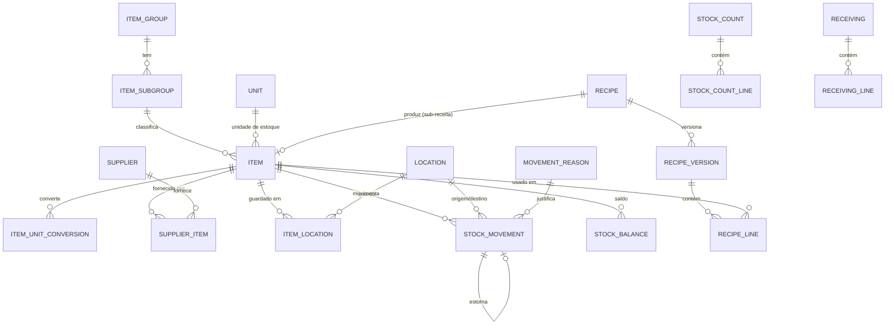

# Estoque — Modelo de dados

> Status: **proposta inicial**, base para o `data-model.md` das features 001–006. Ajustes feitos no
> `speckit plan` devem voltar para este arquivo.
> Regras de negócio: [`docs/produto/estoque/`](../../produto/estoque/00-visao-geral.md).

Todas as tabelas têm `id uuid pk`, `restaurant_id uuid not null`, `created_at timestamptz`,
`created_by uuid`. Tabelas editáveis têm também `updated_at`/`updated_by`. Omitidos abaixo.

## Diagrama

## Cadastros

### `units`
| Coluna | Tipo | Notas |
|---|---|---|
| code | text | `kg`, `g`, `l`, `ml`, `un` — global, não por restaurante |
| dimension | enum | `MASS`, `VOLUME`, `COUNT` |
| to_base | numeric | Fator para a unidade base da dimensão (g, ml, un) |

### `item_groups` / `item_subgroups`
| Coluna | Tipo | Notas |
|---|---|---|
| code | text | 2 dígitos, único no restaurante (grupo) / no grupo (subgrupo) |
| name | text | |
| in_cogs | boolean | Só no grupo; padrão de "entra no CMV" |
| is_food | boolean | Só no grupo; alimentar × não alimentar |

### `items`
| Coluna | Tipo | Notas |
|---|---|---|
| code | text | `GG.SS.NNNN`, gerado, imutável, único |
| description | text | Padronizada; índice único em (subgroup, descrição normalizada) para ativos |
| type | enum | `INGREDIENT`, `RESALE`, `PRODUCED`, `CONSUMABLE`, `ASSET` |
| subgroup_id | uuid fk | |
| financial_category | text | |
| stock_unit_id | uuid fk | **Bloqueado** após a 1ª movimentação |
| recipe_unit_id | uuid fk | |
| ean | text null | |
| catch_weight | boolean | Peso variável |
| correction_factor | numeric(8,4) | FC padrão, ≥ 1 |
| yield_factor | numeric(8,4) null | Ex.: chope 0,90 |
| average_cost | numeric(14,4) | Por unidade de estoque; mantido pelo livro |
| last_cost | numeric(14,4) | |
| cost_updated_at | timestamptz | |
| cost_tolerance_pct | numeric(5,2) | Ex.: 5,00 |
| safety_margin | numeric(5,4) | 0,10–0,25 |
| reorder_point / par_level | numeric(14,4) | Calculados ou manuais (flag `reorder_manual`) |
| storage_temp_max_c | numeric(4,1) | |
| receiving_temp_min_c / max_c | numeric(4,1) | |
| shelf_life_days / opened_life_days | int | |
| lot_control | boolean | |
| expiry_alert_days | int | |
| allergens | text[] | Lista RDC 26/2015 |
| ncm / cest / origin / tax_group | text | |
| abc_class | char(1) null | **Escrita só pelo job de fechamento** |
| in_cogs_override | boolean null | Sobrescreve o grupo |
| active / countable | boolean | |
| count_frequency | enum | `SHIFT`, `DAILY`, `WEEKLY`, `BIWEEKLY`, `MONTHLY`, `QUARTERLY` |

### `item_unit_conversions`
Conversões específicas do item (ex.: 1 `un` de ovo = 50 `g`), quando a dimensão muda.

### `suppliers`
Campos de [03-fornecedores](../../produto/estoque/03-fornecedores.md): legal, contato, sanitário,
logística (`lead_time_days`, `delivery_days int[]`, `min_order_value`), financeiro, `status`
(`APPROVED`, `UNDER_REVIEW`, `BLOCKED`). CNPJ único por restaurante.

### `supplier_items`
| Coluna | Tipo | Notas |
|---|---|---|
| supplier_id, item_id | uuid fk | único juntos + `supplier_code` |
| supplier_code | text | Código na NF-e (de-para) |
| purchase_unit_label | text | "Caixa 12 un." |
| conversion_factor | numeric(14,4) | Unidades de estoque por unidade de compra, > 0 |
| current_price | numeric(14,4) | Por unidade de compra |
| preferred | boolean | No máximo um por item |

### `locations`
| Coluna | Tipo | Notas |
|---|---|---|
| name | text | Nome real do espaço |
| kind | enum | `DRY`, `CHILLED`, `FROZEN`, `QUARANTINE`, `IN_TRANSIT`, `CHEMICALS`, `STATION`, `BAR`, `NON_FOOD` |
| temp_min_c / temp_max_c | numeric(4,1) null | Obrigatório se `CHILLED`/`FROZEN` (check constraint) |
| responsible_user_id | uuid | |
| count_order | int | Rota de contagem |

### `item_locations`
`item_id`, `location_id`, `is_default`, `sheet_position`.

## Livro e projeções

### `movement_reasons`
Lista fechada por tipo de movimentação (`movement_type`, `code`, `label`, `family`). Seed inicial
vem de [06-movimentacoes](../../produto/estoque/06-movimentacoes.md#motivos-de-perda-lista-fechada-inicial).

### `stock_movements` (só inserção)
| Coluna | Tipo | Notas |
|---|---|---|
| type | enum | Os 13 tipos (ver [03-movimentacoes-e-saldo](03-movimentacoes-e-saldo.md)) |
| item_id | uuid fk | |
| location_id | uuid fk | Local afetado por esta linha |
| quantity | numeric(14,4) | **Com sinal**, na unidade de estoque (+ entra, − sai) |
| original_quantity / original_unit | numeric / text | Como foi digitado (rastreio) |
| unit_cost | numeric(14,4) | Custo no momento |
| total_cost | numeric(14,2) | |
| reason_id | uuid fk | Obrigatório |
| notes | text null | Observação livre |
| occurred_at | timestamptz | Data do fato |
| recorded_at | timestamptz | Data do lançamento |
| recorded_by / approved_by | uuid | `approved_by <> recorded_by` salvo modo operação pequena |
| lot / expiry_date | text / date null | |
| document_type / document_ref | text null | NF-e, OP, requisição… |
| group_id | uuid | Agrupa as linhas de uma mesma operação (ex.: transferência = 2 linhas) |
| reverses_id | uuid null fk | Estorno aponta para a original |
| cost_center | text null | |

Proteções:

- Permissão de banco do usuário da aplicação: `INSERT` e `SELECT` apenas (sem `UPDATE`/`DELETE`).
- Trigger que rejeita `UPDATE`/`DELETE` como segunda barreira.

### `stock_balances` (projeção)
`item_id`, `location_id`, `quantity`, `updated_at`. Atualizada **na mesma transação** que insere a
movimentação. Pode ser reconstruída a qualquer momento somando o livro (teste de integração verifica
que projeção = soma do livro).

### `stock_counts` / `stock_count_lines`
Cabeçalho (local, tipo: `CYCLE`, `WEEKLY`, `MONTHLY`, `ANNUAL_FISCAL`, status, contadores). Linhas
com `counted_quantity`, `system_quantity_snapshot` (gravado no fechamento, **nunca enviado à tela de
contagem**), `recount_quantity`.

### `receivings` / `receiving_lines`
Linhas com `blind_quantity`, `weighed_quantity`, `invoice_quantity`, `ordered_quantity`,
`temperature_c`, `expiry_date`, `lot`, `packaging_ok`, `decision` (`ACCEPTED`, `REJECTED`),
`divergence_type`. A API de conferência não devolve `invoice_quantity`/`ordered_quantity` ao
estoquista.

### Fichas técnicas
- `recipes`: `code`, `name`, `kind` (`DISH`, `SUB_RECIPE`), `produced_item_id` (sub-receita).
- `recipe_versions`: `valid_from`, `yield_quantity`, `portions`, `portion_weight`, `cooking_index`,
  `sale_price`. Versão nova a cada mudança.
- `recipe_lines`: `item_id` **ou** `sub_recipe_id`, `net_quantity`, `recipe_unit_id`,
  `correction_factor` (copiado do item, editável).

### Sanitário
- `temperature_readings`: `location_id`, `read_at`, `temperature_c`, `read_by`, `out_of_range`.
- `labels`: `item_id`, `event` (`OPENED`, `PORTIONED`, `PREPARED`, `THAWING`), `event_at`,
  `expires_at` (calculado, imutável), `brand`, `supplier`, `storage`, `responsible`, `lot`.
- Retenção mínima: 180 dias (job de limpeza não apaga antes disso).
