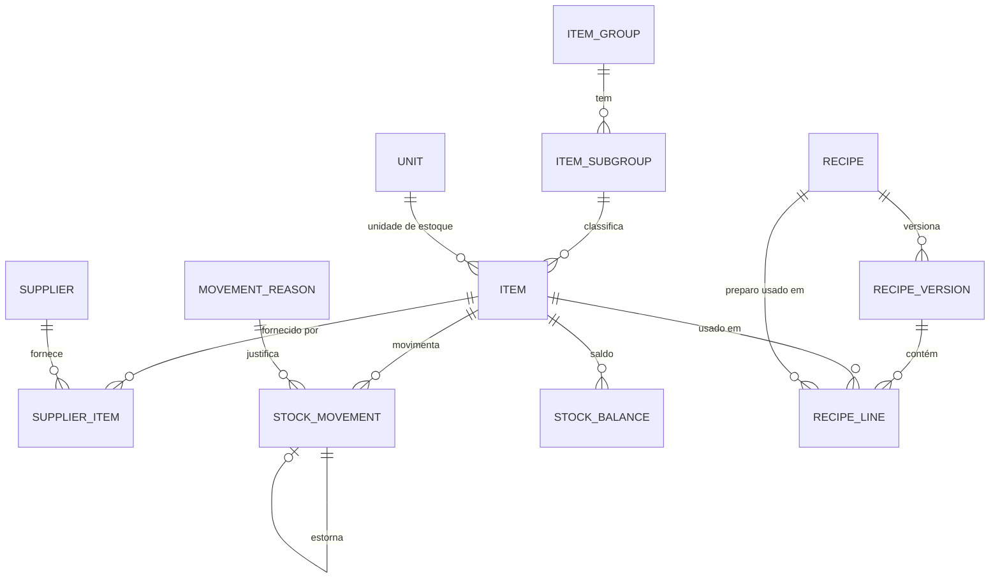

# Estoque — Modelo de dados

> Status: **proposta inicial**, base para o `data-model.md` das features 001–006. Feature 001
> detalhada em [`specs/001-cadastros-base/data-model.md`](../../../specs/001-cadastros-base/data-model.md)
> (inclui `restaurants`, `memberships`, `invitations`, `audit_log`). Ajustes feitos no
> `speckit plan` devem voltar para este arquivo.
> Regras de negócio: [`docs/produto/estoque/`](../../produto/estoque/00-visao-geral.md).

Todas as tabelas têm `id uuid pk`, `restaurant_id uuid not null`, `created_at timestamptz`,
`created_by uuid`. Tabelas editáveis têm também `updated_at`/`updated_by`. Omitidos abaixo.

## Diagrama

## Cadastros

### `units`
| Coluna | Tipo | Notas |
|---|---|---|
| code | text | `kg`, `g`, `l`, `ml`, `un` — global, não por restaurante |
| dimension | enum | `MASS`, `VOLUME`, `COUNT` |
| to_base | numeric | Fator para a unidade base da dimensão (g, ml, un) |

### `item_groups` / `item_subgroups`
| Coluna | Tipo | Notas |
|---|---|---|
| code | text | 2 dígitos, único no restaurante (grupo) / no grupo (subgrupo) |
| name | text | |
| in_cogs | boolean | Só no grupo; padrão de "entra no CMV" |
| storage_class | enum | Só no grupo; `FOOD`, `CHEMICAL`, `OTHER_NON_FOOD` (substitui `is_food`; feature 001) |
| is_system | boolean | Só no grupo; árvore padrão, não inativa |
| next_subgroup_code / next_item_seq | int | Contadores de código (feature 001) |

### `items`
> Simplificado na feature 002 (migração `0002_simplify_items`).

| Coluna | Tipo | Notas |
|---|---|---|
| code | text | `GG.SS.NNNN`, gerado, imutável, único |
| description | text | Nome do item |
| description_normalized | text | Índice único parcial (subgroup, normalizada) onde `active` |
| type | enum | `INGREDIENT`, `RESALE`, `PRODUCED`, `CONSUMABLE`, `ASSET` |
| subgroup_id | uuid fk | |
| stock_unit_id | uuid fk | A medida do item. **Bloqueada** após a 1ª movimentação (`stock_unit_locked_at`) |
| stock_unit_locked_at | timestamptz null | Preenchido na 1ª movimentação |
| purchase_unit_label / purchase_factor | text null / numeric(14,4) null | Embalagem de compra e quanto vem nela, na medida do item. Os dois nulos ou os dois preenchidos (`factor > 0`) |
| average_cost / last_cost / cost_updated_at | numeric / numeric / timestamptz | Mantidos pelo livro |
| abc_class | char(1) null | Reservado; não aparece na tela |
| in_cogs_override | boolean null | Sobrescreve o grupo |
| reorder_point / par_level | numeric(14,4) null | Aviso de reposição (feature 006, migração `0007_reorder_levels`): "avisar quando chegar em" e "comprar até", na medida do item. Checks: ponto ≥ 0; `par_level` só com ponto e maior que ele |
| active | boolean | |

Removidos na feature 002: `recipe_unit_id`, `item_unit_conversions`, EAN/GTIN, fiscais, sanitários,
pesos, FC, rendimento, alérgenos, `countable`, `count_frequency`.

### `suppliers` (feature 007, migração `0006_suppliers`)
Só dados comerciais (sem sanitário, fiscal nem bancário).

| Coluna | Tipo | Notas |
|---|---|---|
| name / name_normalized | text | Único entre ativos (`suppliers_active_name`) |
| legal_name | text null | Razão social |
| cnpj | char(14) null | Sem pontuação, maiúsculas; numérico ou alfanumérico. Único por restaurante (`suppliers_cnpj`) |
| contact_name, phone, email | text null | |
| delivery_days | smallint[] | 0 = domingo … 6 = sábado (check) |
| lead_time_days | smallint null | 0 a 90 |
| min_order_value | numeric(14,2) null | ≥ 0 |
| payment_terms, notes | text null | Texto livre |
| active | boolean | Falso = **bloqueado**; nunca é apagado |
| version | int | Trava otimista |

### `supplier_items` (feature 007)
| Coluna | Tipo | Notas |
|---|---|---|
| supplier_id, item_id | uuid fk | Únicos juntos (`supplier_items_supplier_item`) |
| package_label / package_quantity | text / numeric(14,4) null | Embalagem do fornecedor e quanto vem, na medida do item. Os dois juntos, quantidade > 0 |
| price | numeric(14,4) | Pela embalagem (ou por medida sem embalagem), > 0 |
| preferred | boolean | No máximo um por item (`supplier_items_preferred`, índice único parcial) |
| version | int | Trava otimista |

Configuração, não livro: `app_user` pode `DELETE` (tirar o item da lista); a remoção fica na
auditoria do fornecedor. Código do fornecedor na NF-e (de-para) fica fora.

### `locations` / `item_locations`
Removidas na feature 002 (migração `0003_remove_locations`). O saldo é um só por item.

## Livro e projeções

### `movement_reasons` (feature 004)
Lista fechada **global** (sem `restaurant_id`, só leitura): `movement_type`, `code`, `label`,
`family`, `position`. Seed na migração `0005_stock_ledger`, igual a
`src/domain/inventory/movement-reasons.ts` (teste de integração compara).

### `stock_movements` (só inserção, feature 004)
| Coluna | Tipo | Notas |
|---|---|---|
| type | enum `movement_type` | `PURCHASE`, `LOSS`, `ADJUSTMENT`, `REVERSAL` nesta versão |
| item_id | uuid fk | |
| quantity | numeric(14,4) | **Com sinal**, na medida do item (+ entra, − sai); nunca zero |
| entered_quantity / entered_unit | numeric / text | Como foi digitado ("3" "Caixa"; "500" "g") |
| unit_cost | numeric(14,4) | Custo no momento |
| total_cost | numeric(14,2) | Com sinal |
| reason_id | uuid fk null | Obrigatório, menos na compra (check `stock_movements_reason`) |
| notes | text null | Observação livre |
| occurred_at | timestamptz | Data do fato |
| created_at / created_by | timestamptz / uuid | Lançamento e quem lançou (no acerto, quem pediu) |
| approved_by | uuid null | Quem aprovou o acerto |
| reverses_id | uuid null fk | Estorno aponta para a original; índice único (estorno único) |
| idempotency_key | text null | Único por restaurante |
| supplier_id | uuid null fk | De quem foi a compra (feature 007). Só em `PURCHASE` (check `stock_movements_supplier_purchase`) |

Proteções: `app_user` só `SELECT, INSERT`; gatilho `app_reject_change` em `UPDATE`/`DELETE`; RLS.

### `stock_balances` (projeção)
`item_id` (pk), `restaurant_id`, `quantity`, `updated_at`. Atualizada **na mesma transação** que
insere a movimentação; o teste de propriedade confere que projeção = soma do livro.

### `adjustment_requests` (feature 004)
`item_id`, `counted_quantity`, `system_quantity`, `difference` (≠ 0), `reason_id`, `notes`,
`status` (`PENDING`, `APPROVED`, `REJECTED`, `CANCELLED`), `created_by` (quem pediu), `decided_by`,
`decided_at`, `decision_notes`, `movement_id`. Check: quem decide não é quem pediu (salvo
cancelamento pelo próprio).

### Relatórios (feature 006, só leitura)
Sem tabela nova. `report-repository.ts` agrega `stock_movements`, `stock_balances`, `items` e o
fornecedor preferido (`supplier_items.preferred`). **Saída** = `quantity < 0`, `type <> 'REVERSAL'`
e sem estorno apontando para ela; **entrada** = `PURCHASE` sem estorno. Período pela data do fato
(`occurred_at`); semanas de segunda a domingo no fuso do restaurante (`generate_series`).

### `items` (custos, feature 004)
`average_cost numeric(18,8)`, `last_cost numeric(14,4)` e `cost_updated_at` passam a ser escritos
pela compra e pelo estorno de compra; `stock_unit_locked_at` na primeira movimentação.

### Produtos (feature 003, migração `0004_recipes`)
- `recipes`: `name`, `name_normalized`, `kind` (`DISH` = vendido, `SUB_RECIPE` = preparo), `active`,
  `version` (trava otimista). Nome único entre ativos do restaurante (`recipes_active_name`).
- `recipe_versions` (só inserção): `recipe_id`, `number`, `valid_from`, `yield_quantity` e
  `yield_unit_id` (só preparo; os dois juntos, quantidade > 0). Versão nova quando muda o
  rendimento ou alguma linha; mudar só o nome não cria versão.
- `recipe_lines` (só inserção): `recipe_version_id`, `position`, `item_id` **ou** `sub_recipe_id`
  (check `recipe_lines_one_component`), `quantity numeric(14,4) > 0`, `unit_id`. Um item ou preparo
  aparece uma vez por versão.
- A linha de preparo aponta para o produto, não para a versão: vale a versão vigente do preparo.
- Gatilho `app_reject_change` em versões e linhas; `app_user` só tem `SELECT, INSERT` nelas. RLS
  por `restaurant_id` nas três tabelas.
- Ainda não existem: FC/IC por linha, porções, preço de venda, item produzido (`PRODUCED`) gerado
  pelo preparo e ordem de produção.

