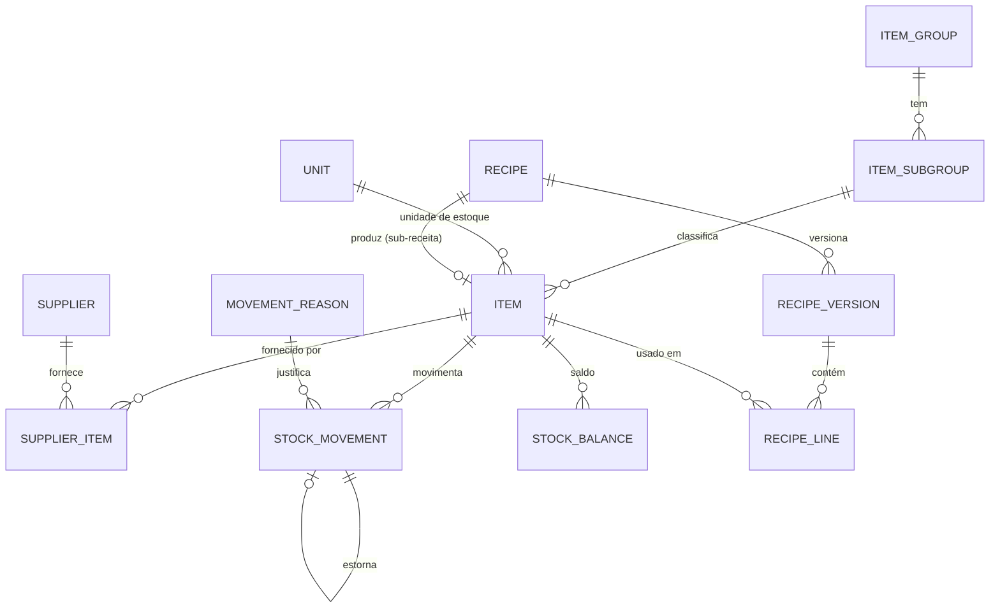

# Estoque — Modelo de dados

> Status: **proposta inicial**, base para o `data-model.md` das features 001–006. Feature 001
> detalhada em [`specs/001-cadastros-base/data-model.md`](../../../specs/001-cadastros-base/data-model.md)
> (inclui `restaurants`, `memberships`, `invitations`, `audit_log`). Ajustes feitos no
> `speckit plan` devem voltar para este arquivo.
> Regras de negócio: [`docs/produto/estoque/`](../../produto/estoque/00-visao-geral.md).

Todas as tabelas têm `id uuid pk`, `restaurant_id uuid not null`, `created_at timestamptz`,
`created_by uuid`. Tabelas editáveis têm também `updated_at`/`updated_by`. Omitidos abaixo.

## Diagrama

## Cadastros

### `units`
| Coluna | Tipo | Notas |
|---|---|---|
| code | text | `kg`, `g`, `l`, `ml`, `un` — global, não por restaurante |
| dimension | enum | `MASS`, `VOLUME`, `COUNT` |
| to_base | numeric | Fator para a unidade base da dimensão (g, ml, un) |

### `item_groups` / `item_subgroups`
| Coluna | Tipo | Notas |
|---|---|---|
| code | text | 2 dígitos, único no restaurante (grupo) / no grupo (subgrupo) |
| name | text | |
| in_cogs | boolean | Só no grupo; padrão de "entra no CMV" |
| storage_class | enum | Só no grupo; `FOOD`, `CHEMICAL`, `OTHER_NON_FOOD` (substitui `is_food`; feature 001) |
| is_system | boolean | Só no grupo; árvore padrão, não inativa |
| next_subgroup_code / next_item_seq | int | Contadores de código (feature 001) |

### `items`
> Simplificado na feature 002 (migração `0002_simplify_items`).

| Coluna | Tipo | Notas |
|---|---|---|
| code | text | `GG.SS.NNNN`, gerado, imutável, único |
| description | text | Nome do item |
| description_normalized | text | Índice único parcial (subgroup, normalizada) onde `active` |
| type | enum | `INGREDIENT`, `RESALE`, `PRODUCED`, `CONSUMABLE`, `ASSET` |
| subgroup_id | uuid fk | |
| stock_unit_id | uuid fk | A medida do item. **Bloqueada** após a 1ª movimentação (`stock_unit_locked_at`) |
| stock_unit_locked_at | timestamptz null | Preenchido na 1ª movimentação |
| purchase_unit_label / purchase_factor | text null / numeric(14,4) null | Embalagem de compra e quanto vem nela, na medida do item. Os dois nulos ou os dois preenchidos (`factor > 0`) |
| average_cost / last_cost / cost_updated_at | numeric / numeric / timestamptz | Mantidos pelo livro |
| abc_class | char(1) null | Reservado; não aparece na tela |
| in_cogs_override | boolean null | Sobrescreve o grupo |
| active | boolean | |

Removidos na feature 002: `recipe_unit_id`, `item_unit_conversions`, EAN/GTIN, fiscais, sanitários,
pesos, FC, rendimento, alérgenos, `countable`, `count_frequency`.

### `suppliers`
Campos de [03-fornecedores](../../produto/estoque/03-fornecedores.md): legal, contato, sanitário,
logística (`lead_time_days`, `delivery_days int[]`, `min_order_value`), financeiro, `status`
(`APPROVED`, `UNDER_REVIEW`, `BLOCKED`). CNPJ único por restaurante.

### `supplier_items`
| Coluna | Tipo | Notas |
|---|---|---|
| supplier_id, item_id | uuid fk | único juntos + `supplier_code` |
| supplier_code | text | Código na NF-e (de-para) |
| purchase_unit_label | text | "Caixa 12 un." |
| conversion_factor | numeric(14,4) | Unidades de estoque por unidade de compra, > 0 |
| current_price | numeric(14,4) | Por unidade de compra |
| preferred | boolean | No máximo um por item |

### `locations` / `item_locations`
Removidas na feature 002 (migração `0003_remove_locations`). O saldo é um só por item.

## Livro e projeções

### `movement_reasons`
Lista fechada por tipo de movimentação (`movement_type`, `code`, `label`, `family`). Seed inicial
vem de [06-movimentacoes](../../produto/estoque/06-movimentacoes.md#motivos-de-perda-lista-fechada-inicial).

### `stock_movements` (só inserção)
| Coluna | Tipo | Notas |
|---|---|---|
| type | enum | Os 13 tipos (ver [03-movimentacoes-e-saldo](03-movimentacoes-e-saldo.md)) |
| item_id | uuid fk | |
| quantity | numeric(14,4) | **Com sinal**, na unidade de estoque (+ entra, − sai) |
| original_quantity / original_unit | numeric / text | Como foi digitado (rastreio) |
| unit_cost | numeric(14,4) | Custo no momento |
| total_cost | numeric(14,2) | |
| reason_id | uuid fk | Obrigatório |
| notes | text null | Observação livre |
| occurred_at | timestamptz | Data do fato |
| recorded_at | timestamptz | Data do lançamento |
| recorded_by / approved_by | uuid | `approved_by <> recorded_by` salvo modo operação pequena |
| lot / expiry_date | text / date null | |
| document_type / document_ref | text null | NF-e, OP, requisição… |
| group_id | uuid | Agrupa as linhas de uma mesma operação (ex.: transferência = 2 linhas) |
| reverses_id | uuid null fk | Estorno aponta para a original |
| cost_center | text null | |

Proteções:

- Permissão de banco do usuário da aplicação: `INSERT` e `SELECT` apenas (sem `UPDATE`/`DELETE`).
- Trigger que rejeita `UPDATE`/`DELETE` como segunda barreira.

### `stock_balances` (projeção)
`item_id`, `quantity`, `updated_at`. Atualizada **na mesma transação** que insere a
movimentação. Pode ser reconstruída a qualquer momento somando o livro (teste de integração verifica
que projeção = soma do livro).

### Fichas técnicas
- `recipes`: `code`, `name`, `kind` (`DISH`, `SUB_RECIPE`), `produced_item_id` (sub-receita).
- `recipe_versions`: `valid_from`, `yield_quantity`, `portions`, `portion_weight`, `cooking_index`,
  `sale_price`. Versão nova a cada mudança.
- `recipe_lines`: `item_id` **ou** `sub_recipe_id`, `net_quantity`, `recipe_unit_id`,
  `correction_factor` (copiado do item, editável).

