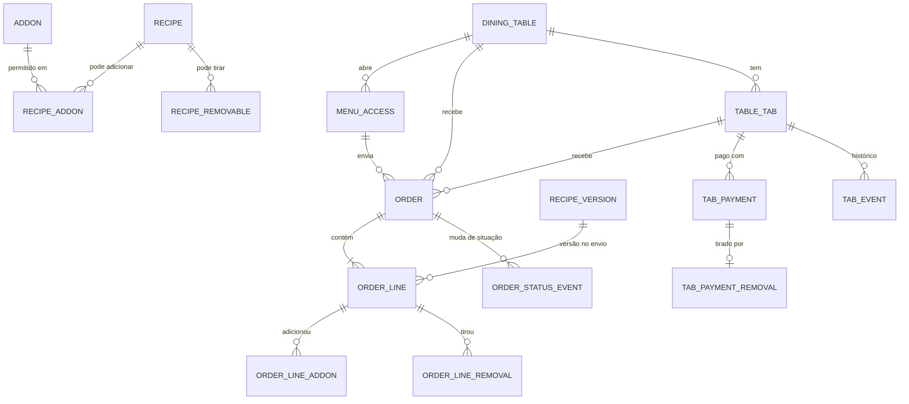

# Pedidos — Modelo de dados

Migrações `0009_ordering` (feature 009), `0010_addons` (feature 010) e `0011_tabs` (feature 011,
[conta da mesa](#conta-da-mesa-feature-011)). Toda tabela nova tem
`id uuid` (UUID v7 gerado na aplicação), `restaurant_id`, `created_at`, `created_by`, RLS
`tenant_isolation` (ver [ADR 0004](../adr/0004-rls-tenant.md)) e `GRANT` para `app_user`; essas
colunas ficam omitidas abaixo. Dinheiro em `numeric(12,2)`, quantidade em `numeric(14,4)`.

## Editáveis (trava otimista: `updated_at`, `updated_by`, `version` → `STALE_RECORD`)

### `dining_tables` (mesa)

| Coluna | Regra |
|---|---|
| `name` | 1 a 30 caracteres (check) |
| `name_normalized` | `normalizeDescription(name)`; único entre ativas: `dining_tables_active_name` (`TABLE_NAME_IN_USE`) |
| `active` | Mesa não é apagada |
| `qr_token` | Único; 32 bytes aleatórios em base64url. Em texto porque está impresso ([ADR 0005](../adr/0005-cardapio-publico.md)) |
| `qr_rotated_at` | Hora do QR code atual. A auditoria de "Trocar QR code" grava só isto, nunca o token |

### `addons` (adicional, 010)

| Coluna | Regra |
|---|---|
| `name`, `name_normalized` | 1 a 40; único entre ativos (`NAME_IN_USE`) |
| `item_id` / `sub_recipe_id` | Exatamente um (check `addons_one_component`); preparo conferido na aplicação (`NOT_A_SUB_RECIPE`) |
| `quantity`, `unit_id` | `> 0`; medida da mesma família do item ou do rendimento do preparo (`UNIT_DIMENSION_MISMATCH`) |
| `price` | `>= 0`; zero = "Grátis" |
| `active` | Não é apagado |

### `recipe_addons` e `recipe_removables` (quadro do produto, 010)

| Tabela | Colunas |
|---|---|
| `recipe_addons` | `recipe_id`, `addon_id` (único com `recipe_id`), `max_times` 1 a 5, `position` |
| `recipe_removables` | `recipe_id`, `item_id` / `sub_recipe_id` (exatamente um, único com `recipe_id`), `label` 1 a 40, `position` |

Trocadas inteiras por `setProductCustomization`, sob a trava otimista de `recipes` (o `version` do
produto sobe; nenhuma `recipe_version` nova).

### Colunas novas em tabelas existentes

| Tabela | Coluna |
|---|---|
| `recipes` | `sold_out_on date` — "Esgotado hoje"; check `sold_out_on is null or kind = 'DISH'`. Vale só no dia gravado |
| `restaurants` | `accepting_qr_orders boolean default true` — chave "Recebendo pedidos pelo QR code" |
| enum `role` | `WAITER` |

## Acesso ao cardápio

### `menu_accesses`

| Coluna | Regra |
|---|---|
| `table_id` | Mesa lida |
| `token_hash` | SHA-256 do token do cookie (único). O token em si nunca vai para o banco |
| `opened_at`, `expires_at` | Check `expires_at = opened_at + interval '20 minutes'` |
| `ended_at` | Nova leitura no mesmo celular encerra o anterior |
| `end_reason` | `RESCAN` (nova leitura) ou `TAB_CLOSED` (conta fechada, 011). Check: preenchido junto com `ended_at` |
| `ip`, `user_agent` | Origem, para investigar abuso |

`created_by` nulo (não há usuário). Índices `(restaurant_id, expires_at)` e
`(restaurant_id, table_id, expires_at)` (fechar a conta encerra os acessos abertos da mesa).

## Pedido — só a situação muda

### `orders`

| Coluna | Regra |
|---|---|
| `table_id`, `menu_access_id` | Mesa e acesso do envio |
| `client_request_id` | Único com `menu_access_id` (`orders_client_request`): envio sem duplicar |
| `business_day`, `number` | Dia local do restaurante e número do dia; únicos juntos |
| `status` | `RECEIVED`, `PREPARING`, `READY`, `DELIVERED`, `CANCELLED` |
| `cancel_reason`, `cancel_note` | Motivo obrigatório só se `CANCELLED`; nota obrigatória se `OTHER`, até 140 |
| `total` | `> 0` |
| `submitted_at`, `status_changed_at`, `version` | |
| `tab_id` | Conta da mesa (011). Nulo só em pedidos de antes da 011. Índice `orders_tab` |

Trigger `orders_status_only`: `UPDATE` só muda situação, motivo, nota, `status_changed_at` e
`version` (o pedido também não troca de conta); `DELETE` é recusado (`APPEND_ONLY`).

### `order_day_counters`

Chave `(restaurant_id, business_day)`, `last_number`. O envio faz upsert `last_number + 1` na mesma
transação (savepoint) que insere o pedido.

### Só inserção (trigger `APPEND_ONLY` em `UPDATE` e `DELETE`)

| Tabela | Colunas |
|---|---|
| `order_lines` | `order_id`, `position`, `recipe_id`, `recipe_version_id` (versão mais nova no envio), `quantity` 1 a 20, `base_price` (`> 0`), `unit_price` (check `>= base_price`) |
| `order_line_addons` | `order_line_id`, `addon_id`, `name`, `times` 1 a 5, `unit_price` (`>= 0`), `item_id` / `sub_recipe_id`, `quantity`, `unit_id` — cópia do adicional no envio |
| `order_line_removals` | `order_line_id`, `item_id` / `sub_recipe_id`, `label` — cópia da retirada no envio |
| `order_status_events` | `order_id`, `from_status` (nulo no envio), `to_status`, `reason`, `user_id` (nulo no envio do cliente), `at` |

Não há coluna de observação livre: a 010 tirou a `note` da linha antes da primeira versão.

## Conta da mesa (feature 011)

Migração `0011_tabs`. Valores em `numeric(12,2)`; taxa em `numeric(5,2)`.

### `table_tabs` (conta da mesa) — editável, trava otimista

| Coluna | Regra |
|---|---|
| `table_id` | Uma conta aberta por mesa: índice único parcial `table_tabs_one_open (restaurant_id, table_id) where status = 'OPEN'` |
| `status` | `tab_status`: `OPEN`, `CLOSED` |
| `opened_at` | Hora do primeiro pedido |
| `service_rate` | Copiada do restaurante ao abrir; nula = sem taxa. Check 0 a 20 |
| `service_waived` | O caixa tirou a taxa desta conta |
| `closed_at`, `closed_by`, `closed_day`, `subtotal`, `service_charge`, `total` | Gravados ao fechar e apagados ao reabrir. Check `table_tabs_closed`: os seis preenchidos se e só se `CLOSED`; check `total = subtotal + service_charge`. `closed_day` é o dia local do restaurante no fechamento (filtro da consulta, índice `(restaurant_id, closed_day)`) |
| `updated_at`, `updated_by`, `version` | O envio de um pedido também soma 1 em `version`: um fechamento que leu a conta antes do pedido recebe `STALE_RECORD` |

Trigger `table_tabs_fixed` (`app_tab_fixed`): `DELETE` recusado; `UPDATE` não troca `id`,
restaurante, criação, mesa, abertura nem `service_rate`. `app_user` tem `SELECT, INSERT, UPDATE`.

### Só inserção (`app_reject_change` em `UPDATE` e `DELETE`; `app_user` só `SELECT, INSERT`)

| Tabela | Colunas |
|---|---|
| `tab_payments` | `tab_id`, `method` (`payment_method`: `CASH`, `PIX`, `DEBIT_CARD`, `CREDIT_CARD`, `OTHER`), `amount` (`> 0`), `received` e `change` (check `tab_payments_cash`: só em `CASH`, `received = amount + change`, `change ≥ 0`), `client_request_id` (único com `tab_id`: toque duplo) |
| `tab_payment_removals` | `payment_id` (único). Pagamento com remoção não conta no pago |
| `tab_events` | `tab_id`, `kind` (`OPENED`, `PAYMENT_ADDED`, `PAYMENT_REMOVED`, `SERVICE_WAIVED`, `SERVICE_RESTORED`, `CLOSED`, `REOPENED`), `reason` (só e sempre em `REOPENED`, 1 a 140), `details` (`jsonb`: pagamento, totais, valores de antes da reabertura), `at`, `user_id` (nulo só em `OPENED`, aberta pelo pedido do cliente). Índice `(tab_id, at)` |

### Colunas novas em tabelas existentes

| Tabela | Coluna |
|---|---|
| `restaurants` | `service_charge_rate numeric(5,2) default 10.00`, check 0 a 20; nula = taxa desligada |
| `orders` | `tab_id` (acima) |
| `menu_accesses` | `end_reason` (acima); os encerramentos antigos viram `RESCAN` na migração |
| enum `role` | `CASHIER` |

## Funções `SECURITY DEFINER` (rota pública)

| Função | Devolve |
|---|---|
| `app_table_by_qr_token(p_token)` | `restaurant_id`, `table_id`, `active` |
| `app_menu_access_by_token_hash(p_hash)` | `restaurant_id`, `menu_access_id` |

`EXECUTE` só para `app_user`. Na aplicação ficam atrás da porta `GlobalLookups`
(`tableByQrToken`, `menuAccessByTokenHash`); depois disso tudo roda em `withTenantTx`.
