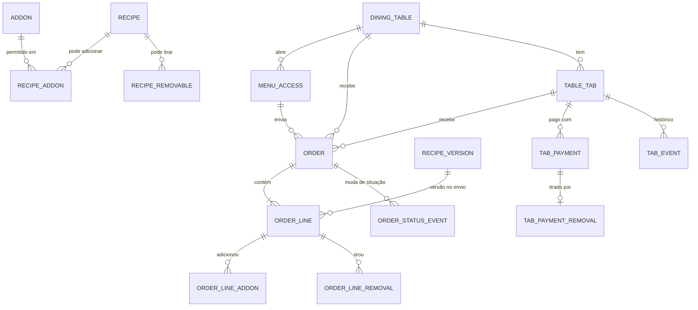

# Pedidos — Modelo de dados

Migrações `0009_ordering` (feature 009), `0010_addons` (feature 010), `0011_tabs` (feature 011,
[conta da mesa](#conta-da-mesa-feature-011)) e `0013_menu_editing` (feature 013,
[cardápio editável](#cardápio-editável-feature-013)). Toda tabela nova tem
`id uuid` (UUID v7 gerado na aplicação), `restaurant_id`, `created_at`, `created_by`, RLS
`tenant_isolation` (ver [ADR 0004](../adr/0004-rls-tenant.md)) e `GRANT` para `app_user`; essas
colunas ficam omitidas abaixo. Dinheiro em `numeric(12,2)`, quantidade em `numeric(14,4)`.

## Editáveis (trava otimista: `updated_at`, `updated_by`, `version` → `STALE_RECORD`)

### `dining_tables` (mesa)

| Coluna | Regra |
|---|---|
| `name` | 1 a 30 caracteres (check) |
| `name_normalized` | `normalizeDescription(name)`; único entre ativas: `dining_tables_active_name` (`TABLE_NAME_IN_USE`) |
| `active` | Mesa não é apagada |
| `qr_token` | Único; 32 bytes aleatórios em base64url. Em texto porque está impresso ([ADR 0005](../adr/0005-cardapio-publico.md)) |
| `qr_rotated_at` | Hora do QR code atual. A auditoria de "Trocar QR code" grava só isto, nunca o token |

### `addons` (adicional, 010)

| Coluna | Regra |
|---|---|
| `name`, `name_normalized` | 1 a 40; único entre ativos (`NAME_IN_USE`) |
| `item_id` / `sub_recipe_id` | Exatamente um (check `addons_one_component`); preparo conferido na aplicação (`NOT_A_SUB_RECIPE`) |
| `quantity`, `unit_id` | `> 0`; medida da mesma família do item ou do rendimento do preparo (`UNIT_DIMENSION_MISMATCH`) |
| `price` | `>= 0`; zero = "Grátis" |
| `active` | Não é apagado |

### `recipe_addons` e `recipe_removables` (quadro do produto, 010)

| Tabela | Colunas |
|---|---|
| `recipe_addons` | `recipe_id`, `addon_id` (único com `recipe_id`), `max_times` 1 a 5, `position` |
| `recipe_removables` | `recipe_id`, `item_id` / `sub_recipe_id` (exatamente um, único com `recipe_id`), `label` 1 a 40, `position` |

Trocadas inteiras por `setProductCustomization`, sob a trava otimista de `recipes` (o `version` do
produto sobe; nenhuma `recipe_version` nova).

### Colunas novas em tabelas existentes

| Tabela | Coluna |
|---|---|
| `recipes` | `sold_out_on date` — "Esgotado hoje"; check `sold_out_on is null or kind = 'DISH'`. Vale só no dia gravado |
| `restaurants` | `accepting_qr_orders boolean default true` — chave "Recebendo pedidos pelo QR code" |
| enum `role` | `WAITER` |

## Acesso ao cardápio

### `menu_accesses`

| Coluna | Regra |
|---|---|
| `table_id` | Mesa lida |
| `token_hash` | SHA-256 do token do cookie (único). O token em si nunca vai para o banco |
| `kind` | `QR` (celular, padrão) ou `TABLET` (tablet fixo na mesa, 016) |
| `opened_at`, `expires_at` | Check `menu_accesses_expiry_by_kind`: no `QR`, `expires_at = opened_at + interval '20 minutes'`; no `TABLET`, nulo (sem prazo) |
| `ended_at` | Nova leitura no mesmo celular encerra o anterior |
| `end_reason` | `RESCAN` (nova leitura), `TAB_CLOSED` (conta fechada, 011, só `QR`), `RELEASED` (gerente liberou o tablet) ou `LINK_ROTATED` (link do tablet trocado). Check: preenchido junto com `ended_at` |
| `last_seen_at` | Sinal de vida do tablet (016), gravado no máximo uma vez por minuto |
| `ip`, `user_agent` | Origem, para investigar abuso |

`created_by` nulo (não há usuário). Índices `(restaurant_id, expires_at)` e
`(restaurant_id, table_id, expires_at)` (fechar a conta encerra os acessos abertos da mesa). Índice
único parcial `menu_accesses_one_tablet` em `(table_id) where kind = 'TABLET' and ended_at is null`:
um tablet ligado por mesa, mesmo com dois aparelhos abrindo o link ao mesmo tempo. Trigger
`menu_accesses_frozen` (016): o acesso só muda em `ended_at`, `end_reason` e `last_seen_at`.

### Tablet da mesa (016) em `dining_tables` e `restaurants`

| Coluna | Regra |
|---|---|
| `dining_tables.tablet_token` | Código do link `/t/{token}` (43 caracteres, único, diferente do QR code). Nulo até **Criar link do tablet** |
| `dining_tables.tablet_token_rotated_at` | Quando o link foi criado ou trocado. Check: preenchido junto com o token |
| `restaurants.logo_base`, `logo_widths` | Logo do cardápio: prefixo na loja de fotos e larguras prontas (96, 192, 384). Check: os dois juntos |
| `restaurants.cover_base`, `cover_widths` | Foto de capa: prefixo e larguras (600, 1200, 1920). Check: os dois juntos |

`orders.source` ganha `TABLET` (check `orders_source_shape`: `QR` e `TABLET` com `menu_access_id`,
`STAFF` com `placed_by`). A função `app_table_by_tablet_token` (SECURITY DEFINER) acha a mesa pelo
link sem saber o restaurante; `app_menu_access_by_token_hash` devolve também o `kind`.

## Pedido — só a situação muda

### `orders`

| Coluna | Regra |
|---|---|
| `table_id`, `menu_access_id` | Mesa e acesso do envio |
| `client_request_id` | Único com `menu_access_id` (`orders_client_request`): envio sem duplicar |
| `business_day`, `number` | Dia local do restaurante e número do dia; únicos juntos |
| `status` | `RECEIVED`, `PREPARING`, `READY`, `DELIVERED`, `CANCELLED` |
| `cancel_reason`, `cancel_note` | Motivo obrigatório só se `CANCELLED`; nota obrigatória se `OTHER`, até 140 |
| `total` | `> 0` |
| `submitted_at`, `status_changed_at`, `version` | |
| `tab_id` | Conta da mesa (011). Nulo só em pedidos de antes da 011. Índice `orders_tab` |
| `source` | `QR` (padrão) ou `STAFF` (015) |
| `placed_by` | Quem da equipe lançou (`users`); índice `orders_placed_by` |

Check `orders_source_shape` (015): `QR` tem `menu_access_id` e não tem `placed_by`; `STAFF` tem
`placed_by` e não tem `menu_access_id`. Envio da equipe sem duplicar: índice único parcial
`orders_staff_client_request (restaurant_id, placed_by, client_request_id) WHERE source = 'STAFF'`.

Trigger `orders_status_only`: `UPDATE` só muda situação, motivo, nota, `status_changed_at` e
`version` (o pedido também não troca de conta, de origem nem de quem lançou); `DELETE` é recusado
(`APPEND_ONLY`). `order_lines.kitchen_note` (015): observação da equipe, nula ou de 1 a 140 letras
(check `order_lines_kitchen_note`). Migração `0015_staff_orders`.

### `order_day_counters`

Chave `(restaurant_id, business_day)`, `last_number`. O envio faz upsert `last_number + 1` na mesma
transação (savepoint) que insere o pedido.

### Só inserção (trigger `APPEND_ONLY` em `UPDATE` e `DELETE`)

| Tabela | Colunas |
|---|---|
| `order_lines` | `order_id`, `position`, `recipe_id`, `recipe_version_id` (versão mais nova no envio), `quantity` 1 a 20, `base_price` (`> 0`), `unit_price` (check `>= base_price`) |
| `order_line_addons` | `order_line_id`, `addon_id`, `name`, `times` 1 a 5, `unit_price` (`>= 0`), `item_id` / `sub_recipe_id`, `quantity`, `unit_id` — cópia do adicional no envio |
| `order_line_removals` | `order_line_id`, `item_id` / `sub_recipe_id`, `label` — cópia da retirada no envio |
| `order_status_events` | `order_id`, `from_status` (nulo no envio), `to_status`, `reason`, `user_id` (nulo no envio do cliente), `at` |

Não há coluna de observação livre: a 010 tirou a `note` da linha antes da primeira versão.

## Conta da mesa (feature 011)

Migração `0011_tabs`. Valores em `numeric(12,2)`; taxa em `numeric(5,2)`.

### `table_tabs` (conta da mesa) — editável, trava otimista

| Coluna | Regra |
|---|---|
| `table_id` | Uma conta aberta por mesa: índice único parcial `table_tabs_one_open (restaurant_id, table_id) where status = 'OPEN'` |
| `status` | `tab_status`: `OPEN`, `CLOSED` |
| `opened_at` | Hora do primeiro pedido |
| `service_rate` | Copiada do restaurante ao abrir; nula = sem taxa. Check 0 a 20 |
| `service_waived` | O caixa tirou a taxa desta conta |
| `closed_at`, `closed_by`, `closed_day`, `subtotal`, `service_charge`, `total` | Gravados ao fechar e apagados ao reabrir. Check `table_tabs_closed`: os seis preenchidos se e só se `CLOSED`; check `total = subtotal + service_charge`. `closed_day` é o dia local do restaurante no fechamento (filtro da consulta, índice `(restaurant_id, closed_day)`) |
| `updated_at`, `updated_by`, `version` | O envio de um pedido também soma 1 em `version`: um fechamento que leu a conta antes do pedido recebe `STALE_RECORD` |

Trigger `table_tabs_fixed` (`app_tab_fixed`): `DELETE` recusado; `UPDATE` não troca `id`,
restaurante, criação, mesa, abertura nem `service_rate`. `app_user` tem `SELECT, INSERT, UPDATE`.

### Só inserção (`app_reject_change` em `UPDATE` e `DELETE`; `app_user` só `SELECT, INSERT`)

| Tabela | Colunas |
|---|---|
| `tab_payments` | `tab_id`, `method` (`payment_method`: `CASH`, `PIX`, `DEBIT_CARD`, `CREDIT_CARD`, `OTHER`), `amount` (`> 0`), `received` e `change` (check `tab_payments_cash`: só em `CASH`, `received = amount + change`, `change ≥ 0`), `client_request_id` (único com `tab_id`: toque duplo) |
| `tab_payment_removals` | `payment_id` (único). Pagamento com remoção não conta no pago |
| `tab_events` | `tab_id`, `kind` (`OPENED`, `PAYMENT_ADDED`, `PAYMENT_REMOVED`, `SERVICE_WAIVED`, `SERVICE_RESTORED`, `CLOSED`, `REOPENED`), `reason` (só e sempre em `REOPENED`, 1 a 140), `details` (`jsonb`: pagamento, totais, valores de antes da reabertura), `at`, `user_id` (nulo só em `OPENED`, aberta pelo pedido do cliente). Índice `(tab_id, at)` |

### Colunas novas em tabelas existentes

| Tabela | Coluna |
|---|---|
| `restaurants` | `service_charge_rate numeric(5,2) default 10.00`, check 0 a 20; nula = taxa desligada |
| `orders` | `tab_id` (acima) |
| `menu_accesses` | `end_reason` (acima); os encerramentos antigos viram `RESCAN` na migração |
| enum `role` | `CASHIER` |

## Caixa do dia (feature 014)

Migração `0014_cash_sessions`. Valores em `numeric(12,2)`. Todas com `restaurant_id`, RLS
`tenant_isolation` e `GRANT` para `app_user`.

### `cash_sessions` (turno do caixa)

| Coluna | Regra |
|---|---|
| `status` | `cash_session_status`: `OPEN`, `CLOSED`. Um turno aberto por restaurante: índice único parcial `where status = 'OPEN'` (`CASH_SESSION_ALREADY_OPEN`) |
| `business_day` | Dia do restaurante em que abriu (o turno que passa da meia-noite fica no dia da abertura); índice `(restaurant_id, business_day)` para Turnos e Vendas |
| `opened_at`, `opened_by`, `opening_float`, `previous_kept`, `opening_note` | Troco ≥ 0; `previous_kept` é o que ficou na gaveta no fechamento anterior |
| `client_request_id` | Id gerado pela tela: o toque duplo em Abrir caixa devolve o mesmo turno (não estava no data-model da spec; entrou na implementação) |
| `closed_at`, `closed_by`, `expected`, `counted`, `difference`, `kept`, `service_charge`, `count_id`, `close_note` | Retrato gravado ao fechar; checks: todos preenchidos se e só se `CLOSED`, `difference = counted − expected`, `0 ≤ kept ≤ counted` |
| `version` | +1 a cada dinheiro que entra ou sai (pagamento, pagamento tirado, sangria, reforço, lançamento tirado) e no fechamento. A contagem guarda a versão; fechar com versão diferente → `COUNT_OUTDATED` |

Trigger `cash_session_closed_is_final`: turno fechado não muda; abertura não muda; `DELETE`
recusado.

### Só inserção (`app_reject_change`)

| Tabela | Colunas |
|---|---|
| `cash_entries` | `kind` (`WITHDRAWAL` sangria, `SUPPLY` reforço), `amount > 0`, `reason` (`SAFE`, `SUPPLIER_PAYMENT`, `DAILY_EXPENSE`, `OTHER`; só e sempre na sangria), `note` (≤ 140), `client_request_id` (único com o turno) |
| `cash_entry_removals` | `entry_id` (único): lançamento tirado deixa de contar |
| `cash_counts` | `counted ≥ 0`, `denominations jsonb` (cédulas da calculadora ou nulo), `session_version` |

Trigger `app_cash_session_must_be_open` (`BEFORE INSERT` em `tab_payments`, `tab_payment_removals`,
`cash_entries` e `cash_counts`): nada entra em turno fechado, mesmo que o código erre.

### Colunas novas em tabelas da 011

| Tabela | Coluna |
|---|---|
| `tab_payments` | `cash_session_id` (turno em que entrou; nulo só nos pagamentos de antes da 014). Índice `(cash_session_id, method)` |
| `tab_payment_removals` | `cash_session_id` (turno em que foi tirado). Índice `(cash_session_id)` |
| `table_tabs` | `cash_session_id` (turno aberto quando a conta fechou; a taxa da conta entra nele) |

## Cardápio editável (feature 013)

### `menu_sections` (seção do cardápio) — editável, trava otimista para renomear

| Coluna | Regra |
|---|---|
| `name` | 1 a 40 caracteres (`INVALID_NAME`) |
| `name_normalized` | Único no restaurante (`NAME_IN_USE`), sem maiúsculas e acentos |
| `position` | Densa (1..n); única adiável `(restaurant_id, position) deferrable initially deferred` |

Apagada de verdade; os produtos dela vão para "Outros" (`menu_section_id = null`) na mesma
transação, e a auditoria guarda o que foi apagado.

### Colunas novas em `recipes`

| Coluna | Regra |
|---|---|
| `description text` | Até 300 caracteres; vazio vira `null` |
| `menu_section_id uuid` | Nulo = "Outros"; chave composta com `restaurant_id` |
| `menu_position integer default 0` | Posição dentro da seção; densa entre os vendidos; `0` em preparo |
| `photo_base text`, `photo_widths smallint[]` | Endereço da foto sem a largura e as larguras gravadas (de `{300, 600, 900, 1200}`) |

Checks `recipes_menu_only_dish` (só produto vendido tem dados de cardápio) e `recipes_photo_pair`
(base e larguras andam juntas). Índice `recipes_menu_order (restaurant_id, kind, menu_section_id,
menu_position)`. Nada disso entra em `recipe_versions`: mudar foto, descrição, seção ou ordem não
cria versão nem muda pedido enviado. Descrição, seção e preço sobem a `version` da linha (trava
otimista); foto e posição não.

Os arquivos da foto ficam fora do banco, em `menu/{photoId}/{largura}.webp` (ver
[ADR 0006](../adr/0006-fotos-do-cardapio.md)).

## Funções `SECURITY DEFINER` (rota pública)

| Função | Devolve |
|---|---|
| `app_table_by_qr_token(p_token)` | `restaurant_id`, `table_id`, `active` |
| `app_menu_access_by_token_hash(p_hash)` | `restaurant_id`, `menu_access_id` |

`EXECUTE` só para `app_user`. Na aplicação ficam atrás da porta `GlobalLookups`
(`tableByQrToken`, `menuAccessByTokenHash`); depois disso tudo roda em `withTenantTx`.
