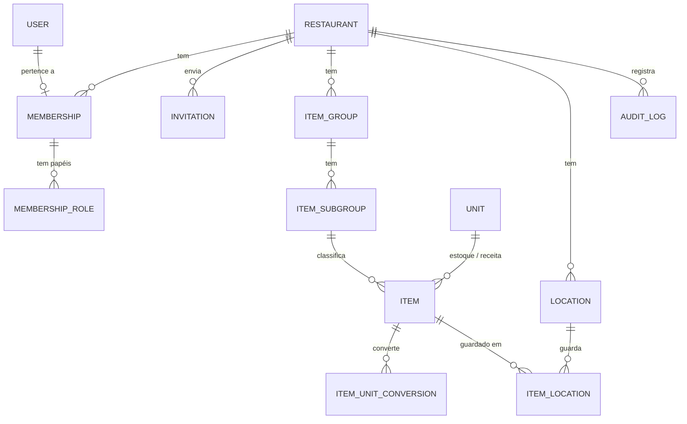

# Data Model: Cadastros base do estoque (feature 001)

**Spec**: [spec.md](spec.md) · **Decisões**: [research.md](research.md) · **Modelo geral**:
[`docs/sistema/estoque/01-modelo-de-dados.md`](../../docs/sistema/estoque/01-modelo-de-dados.md)

Convenções de [02-convencoes](../../docs/sistema/02-convencoes.md): tabelas no plural em
`snake_case`, `id uuid` (v7, gerado na aplicação), `created_at`/`created_by` em todas;
`updated_at`/`updated_by`/`version` nas editáveis. Todas as tabelas com `restaurant_id` têm RLS
(R4). Essas colunas comuns estão omitidas abaixo.

## Diagrama



## Acesso

### `users`, `sessions`, `accounts`, `verifications`
Tabelas do Better Auth (R3), sem `restaurant_id`. Do lado do domínio só importam `users.id`,
`users.email` (único, minúsculo) e `users.name`.

### `restaurants`
| Coluna | Tipo | Regras |
|---|---|---|
| name | text not null | 2–120 caracteres |
| timezone | text not null | Padrão `America/Sao_Paulo` |
| next_group_code | int not null | Contador para códigos de grupo (R6), começa após a árvore padrão |

Sem RLS por `restaurant_id` (a política é `id = app.restaurant_id`).

### `memberships`
| Coluna | Tipo | Regras |
|---|---|---|
| restaurant_id | uuid fk | |
| user_id | uuid fk | **Único** (um restaurante por usuário nesta feature) |
| active | boolean | Desativado não entra (cenário 5.4) |

### `membership_roles`
`membership_id`, `role` enum `MANAGER`, `CHEF`, `STOCKKEEPER`, `BUYER`, `ADMINISTRATIVE`;
único `(membership_id, role)`. **Invariante** (domínio + teste de integração): todo restaurante tem
≥ 1 membership ativa com `MANAGER` (`LAST_MANAGER` ao violar).

### `invitations`
| Coluna | Tipo | Regras |
|---|---|---|
| email | text | Minúsculo |
| roles | role[] | ≥ 1 |
| token_hash | text | Token enviado por e-mail; guarda só o hash |
| expires_at | timestamptz | 7 dias |
| status | enum | `PENDING` → `ACCEPTED` \| `REVOKED` \| `EXPIRED` |

Único `(restaurant_id, email) where status = 'PENDING'`.

## Unidades

### `units` (global, sem `restaurant_id`, sem RLS, só leitura para a aplicação)
| code | dimension | to_base | Rótulo |
|---|---|---|---|
| `g` | MASS | 1 | grama |
| `kg` | MASS | 1000 | quilograma |
| `ml` | VOLUME | 1 | mililitro |
| `l` | VOLUME | 1000 | litro |
| `un` | COUNT | 1 | unidade |

Seed por migração. Novas unidades só por migração.

### `item_unit_conversions`
| Coluna | Tipo | Regras |
|---|---|---|
| item_id | uuid fk | |
| from_unit_id | uuid fk | |
| to_unit_id | uuid fk | Dimensão diferente de `from_unit` |
| factor | numeric(14,4) | > 0. "1 `from` = factor `to`" (1 un = 50 g) |

Único `(item_id, from_dimension, to_dimension)`; o inverso é calculado, não guardado.

## Grupos

### `item_groups`
| Coluna | Tipo | Regras |
|---|---|---|
| code | char(2) | Gerado, único no restaurante, imutável |
| name | text | Editável; único entre ativos no restaurante |
| storage_class | enum | `FOOD`, `CHEMICAL`, `OTHER_NON_FOOD` (R12) |
| in_cogs | boolean | Padrão de "entra no CMV" |
| is_system | boolean | Árvore padrão: não apaga nem inativa (FR-010) |
| active | boolean | |
| next_subgroup_code | int | Contador (R6) |

### `item_subgroups`
| Coluna | Tipo | Regras |
|---|---|---|
| group_id | uuid fk | |
| code | char(2) | Gerado, único no grupo, imutável |
| name | text | Único entre ativos no grupo |
| active | boolean | Só inativa sem itens ativos (`SUBGROUP_HAS_ACTIVE_ITEMS`) |
| next_item_seq | int | Começa em 1 (R6) |

Seed da árvore padrão (grupos + subgrupos de exemplo de
[01-grupos-de-itens](../../docs/produto/estoque/01-grupos-de-itens.md#árvore-de-grupos-padrão)) roda
no caso de uso "criar restaurante", a partir de uma constante em `src/domain/inventory/default-tree.ts`.

## Locais

### `locations`
| Coluna | Tipo | Regras |
|---|---|---|
| name | text | Único entre ativos no restaurante (FR-015) |
| kind | enum | `DRY`, `CHILLED`, `FROZEN`, `QUARANTINE`, `IN_TRANSIT`, `CHEMICALS`, `STATION`, `BAR`, `NON_FOOD` |
| temp_min_c / temp_max_c | numeric(4,1) null | Obrigatórios se `CHILLED`/`FROZEN`; `min ≤ max` (check) |
| responsible_user_id | uuid fk null | Membro ativo do restaurante |
| count_order | int | ≥ 0; empate desempata por nome |
| is_system | boolean | Quarentena: não apaga nem inativa (FR-014) |
| active | boolean | Inativar exige nenhum vínculo item-local (`LOCATION_IN_USE`) |

Único `(restaurant_id) where kind = 'QUARANTINE' and is_system`.

### `item_locations`
| Coluna | Tipo | Regras |
|---|---|---|
| item_id, location_id | uuid fk | Único juntos |
| is_default | boolean | No máximo um por item: único parcial `(item_id) where is_default` |
| sheet_position | int | ≥ 1; ordem na folha do local |

Validação de compatibilidade `checkItemLocation` (R12) no caso de uso.

## Itens

### `items`
| Coluna | Tipo | Regras / origem |
|---|---|---|
| code | text | `GG.SS.NNNN`, gerado, imutável, único no restaurante (FR-018) |
| description | text | 3–200 caracteres |
| description_normalized | text | `normalizeDescription(description)`; único parcial com subgrupo onde `active` (FR-019) |
| type | enum | `INGREDIENT`, `RESALE`, `PRODUCED`, `CONSUMABLE`, `ASSET` |
| subgroup_id | uuid fk | Subgrupo ativo; grupo derivado |
| stock_unit_id | uuid fk | Trigger bloqueia mudança se `stock_unit_locked_at` (R8) |
| stock_unit_locked_at | timestamptz null | Preenchido pela feature 003 |
| recipe_unit_id | uuid fk | Se dimensão ≠ estoque, exige `item_unit_conversions` (FR-021) |
| purchase_unit_label | text | Ex.: "Caixa 20 kg" |
| purchase_factor | numeric(14,4) | > 0, em unidades de estoque (FR-020) |
| in_cogs_override | boolean null | `null` = segue o grupo (FR-024) |
| ean_unit / ean_package | text null | 8, 12, 13 ou 14 dígitos com dígito verificador |
| no_gtin | boolean | Se `true`, EANs nulos |
| financial_category | text null | |
| presentation | text null | "lata 2,8 kg" |
| net_weight / drained_weight | numeric(14,4) null | Na unidade de estoque se massa |
| catch_weight | boolean | Peso variável |
| correction_factor | numeric(8,4) | ≥ 1, padrão 1 |
| yield_factor | numeric(8,4) null | > 0 e ≤ 1 |
| storage_temp_max_c | numeric(4,1) null | |
| receiving_temp_min_c / max_c | numeric(4,1) null | min ≤ max |
| shelf_life_days / opened_life_days | int null | ≥ 0 |
| lot_control | boolean | |
| expiry_alert_days | int null | ≥ 0 |
| allergens | text[] | Subconjunto da lista RDC 727/2022, antiga RDC 26/2015 (R13) |
| ncm | text null | 8 dígitos |
| cest | text null | 7 dígitos |
| origin | char(1) null | 0–8 (tabela de origem da NF-e) |
| tax_group | text null | |
| countable | boolean | Padrão `true` |
| count_frequency | enum null | `SHIFT`, `DAILY`, `WEEKLY`, `BIWEEKLY`, `MONTHLY`, `QUARTERLY` |
| average_cost / last_cost | numeric(14,4) null | **Só leitura** nesta feature (FR-026) |
| cost_updated_at | timestamptz null | Só leitura |
| abc_class | char(1) null | Só leitura; escrito pelo job da feature 009 |
| active | boolean | |

Ficaram de fora (outras features): `cost_tolerance_pct`, `safety_margin`, `reorder_point`,
`par_level`, `reorder_manual` → 003/007.

### Estados do item

```text
ATIVO ──inativar──▶ INATIVO
  ▲                    │
  └──reativar──────────┘   (recusa se já houver ativo com a mesma descrição normalizada no subgrupo)
```

O mesmo vale para locais, grupos e subgrupos (com as restrições de `is_system` e de uso).

## Auditoria

### `audit_log` (só inserção)
| Coluna | Tipo | Notas |
|---|---|---|
| entity | text | `item`, `location`, `item_group`, `item_subgroup`, `item_location`, `membership`, `invitation` |
| entity_id | uuid | |
| action | enum | `CREATE`, `UPDATE`, `DEACTIVATE`, `REACTIVATE`, `DENIED` |
| changes | jsonb | `{campo: [antes, depois]}` |
| user_id | uuid | |
| occurred_at | timestamptz | Do `Clock` injetado |
| origin | jsonb | `{channel: "web", ip, userAgent}` |

Papel da aplicação: `INSERT`/`SELECT` apenas; trigger recusa `UPDATE`/`DELETE`.

## Regras de domínio (funções puras, `src/domain/`)

| Função | Arquivo | Requisito | Erros |
|---|---|---|---|
| `convert(qty, from, to, itemConversions?)` | `inventory/units.ts` | FR-006, FR-007, FR-022 | `UNIT_DIMENSION_MISMATCH` |
| `toStockUnit(qty, purchaseFactor)` / `fromStockUnit` | `inventory/units.ts` | FR-020, FR-022 | `INVALID_FACTOR` |
| `formatItemCode(g, s, seq)` | `inventory/item-code.ts` | FR-018 | `SUBGROUP_SEQUENCE_EXHAUSTED` |
| `nextTwoDigitCode(counter)` | `inventory/item-code.ts` | FR-009 | `GROUP_CODES_EXHAUSTED` |
| `normalizeDescription(text)` | `inventory/description.ts` | FR-019 | – |
| `validateItem(input, units)` | `inventory/item.ts` | FR-020, FR-021, FR-025 | `MISSING_ITEM_CONVERSION`, `INVALID_CORRECTION_FACTOR`, `INVALID_YIELD_FACTOR`, `INVALID_EAN`, … |
| `canChangeStockUnit(item)` | `inventory/item.ts` | FR-023 | `ITEM_UNIT_LOCKED` |
| `effectiveInCogs(group, item)` | `inventory/item.ts` | FR-024 | – |
| `validateLocation(input)` | `inventory/location.ts` | FR-013 | `TEMPERATURE_RANGE_REQUIRED`, `TEMPERATURE_RANGE_INVALID` |
| `checkItemLocation(storageClass, kind)` | `inventory/location.ts` | FR-029 | `LOCATION_INCOMPATIBLE` |
| `orderCountSheet(links)` | `inventory/location.ts` | FR-016 | – |
| `can(roles, action)` | `access/permissions.ts` | FR-003 | `FORBIDDEN` |
| `assertKeepsManager(memberships, change)` | `access/memberships.ts` | FR-002 | `LAST_MANAGER` |
| `diffFields(before, after)` | `shared/audit.ts` | FR-004 | – |
| `parseBrDecimal` / `formatBrDecimal` | `shared/decimal.ts` | FR-032 | `INVALID_NUMBER` |
