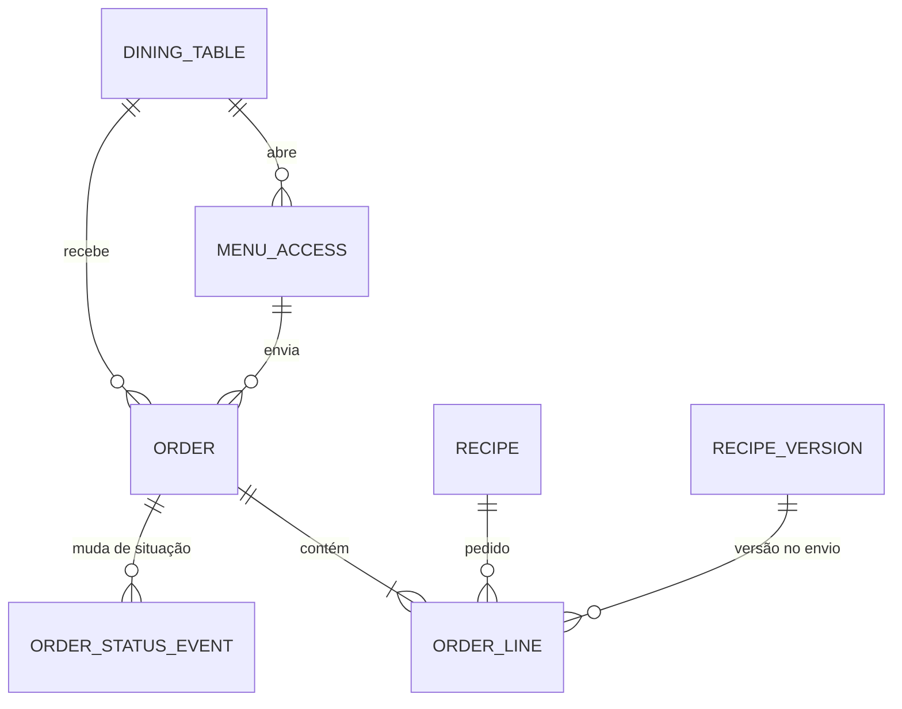

# Modelo de dados: 009 — Pedidos pelo QR code da mesa

Migração `0009_ordering`. Toda tabela nova tem `id uuid pk` (UUID v7 gerado na aplicação),
`restaurant_id`, `created_at`, `created_by` (`base`), RLS `tenant_isolation` e `GRANT` para
`app_user`. Omitidos abaixo.



## `dining_tables` (mesa) — editável

| Coluna | Tipo | Regra |
|---|---|---|
| `name` | `text` | 1 a 30 caracteres, sem espaço nas pontas |
| `name_normalized` | `text` | `normalizeDescription(name)` (sem acento, minúsculas). Único entre ativas: índice `(restaurant_id, name_normalized) where active` (`TABLE_NAME_IN_USE`) |
| `active` | `boolean` default `true` | Mesa não é apagada |
| `qr_token` | `text` único | Token do link (32 bytes, base64url). Em texto: está impresso na mesa ([R1](research.md#r1-link-do-qr-code-e-como-achar-o-restaurante-sem-login)) |
| `qr_rotated_at` | `timestamptz` | Quando o QR code atual foi gerado |
| `updated_at`, `updated_by`, `version` | | Trava otimista (`STALE_RECORD`) |

"Criar várias mesas" de A a B (inteiros, 1 a 999, até 200 de uma vez): cria os nomes que ainda não
existem entre as ativas e devolve quantas criou e quantas pulou.

## `menu_accesses` (acesso ao cardápio)

| Coluna | Tipo | Regra |
|---|---|---|
| `table_id` | `uuid` → `dining_tables` | |
| `token_hash` | `text` único | SHA-256 do token do cookie |
| `opened_at` | `timestamptz` | Hora do servidor na leitura |
| `expires_at` | `timestamptz` | `opened_at + 20 min`; check `expires_at = opened_at + interval '20 minutes'` |
| `ended_at` | `timestamptz` null | Nova leitura no mesmo celular encerra o anterior |
| `ip`, `user_agent` | `text` null | Origem, para investigar abuso |

Aberto se `ended_at is null` e `agora ≤ expires_at`. Envio aceito até `expires_at + 15 s`.
Índice `(restaurant_id, expires_at)` para contar acessos abertos. `created_by` fica nulo (não há
usuário).

## `orders` (pedido)

| Coluna | Tipo | Regra |
|---|---|---|
| `table_id` | `uuid` → `dining_tables` | Mesa do acesso no envio |
| `menu_access_id` | `uuid` → `menu_accesses` | |
| `client_request_id` | `uuid` | Único com `menu_access_id` (envio sem duplicar) |
| `business_day` | `date` | Dia local do restaurante no envio |
| `number` | `integer` | Único com `(restaurant_id, business_day)` |
| `status` | enum `order_status`: `RECEIVED`, `PREPARING`, `READY`, `DELIVERED`, `CANCELLED` | |
| `cancel_reason` | enum `order_cancel_reason` null: `CUSTOMER_GAVE_UP`, `OUT_OF_PRODUCT`, `IMPROPER_ORDER`, `OTHER` | Obrigatório se `CANCELLED` (check) |
| `cancel_note` | `text` null | Até 140; obrigatório se motivo `OTHER` |
| `total` | `numeric(12,2)` | Soma das linhas; check `> 0` |
| `submitted_at` | `timestamptz` | |
| `status_changed_at` | `timestamptz` | Para "há quanto tempo" e "atrasado" |
| `version` | `integer` | Trava otimista nas mudanças de situação (`STALE_RECORD`) |

Índices: `(restaurant_id, status, submitted_at)` para a cozinha e o garçom;
`(restaurant_id, business_day)` para a consulta. Trigger impede mudar qualquer coluna além de
`status`, `cancel_reason`, `cancel_note`, `status_changed_at` e `version`; `DELETE` proibido.

### Situações

```text
RECEIVED ──► PREPARING ──► READY ──► DELIVERED
    │            │           │
    └────────────┴───────────┴──► CANCELLED (com motivo)
```

Só para frente, um passo por vez (o garçom marca `READY → DELIVERED`). `DELIVERED` e `CANCELLED`
são finais. Transição inválida: `INVALID_ORDER_TRANSITION`. "Atrasado": `status` em `RECEIVED` ou
`PREPARING` e `agora − submitted_at > 20 min`.

## `order_lines` (linha do pedido) — só inserção

| Coluna | Tipo | Regra |
|---|---|---|
| `order_id` | `uuid` → `orders` | |
| `position` | `integer` | Ordem em que o cliente pôs |
| `recipe_id` | `uuid` → `recipes` | Produto vendido |
| `recipe_version_id` | `uuid` → `recipe_versions` | Versão mais nova no envio (a 005 baixa por ela) |
| `quantity` | `integer` | 1 a 20 (check) |
| `unit_price` | `numeric(12,2)` | Produto + adicionais no envio (010); check `unit_price >= base_price` |
| `base_price` | `numeric(12,2)` | Preço de venda do produto no envio; check `> 0` ([010](../010-adicionais-retiradas/data-model.md)) |

Até 30 linhas por pedido (domínio). O mesmo produto pode aparecer em duas linhas com observações
diferentes. Trigger `app_reject_change` em `UPDATE`/`DELETE`.

## `order_status_events` (mudança de situação) — só inserção

| Coluna | Tipo | Regra |
|---|---|---|
| `order_id` | `uuid` → `orders` | |
| `from_status` | `order_status` null | Nulo no envio |
| `to_status` | `order_status` | |
| `reason` | `order_cancel_reason` null | Só no cancelamento |
| `user_id` | `uuid` null | Nulo no envio do cliente |
| `at` | `timestamptz` | |

Gravada na mesma transação que muda `orders.status`.

## `order_day_counters`

| Coluna | Tipo | Regra |
|---|---|---|
| `restaurant_id` + `business_day` | pk | Sem `id` próprio |
| `last_number` | `integer` | Último número usado no dia |

## Mudanças em tabelas existentes

| Tabela | Mudança |
|---|---|
| `recipes` | `sold_out_on date null`; check `sold_out_on is null or kind = 'DISH'`. Auditado como "Esgotado" |
| `restaurants` | `accepting_qr_orders boolean not null default true`. Auditado como "Recebendo pedidos pelo QR code" |
| enum `role` | `+ 'WAITER'` |

## Funções `SECURITY DEFINER` (rota pública)

- `app_table_by_qr_token(p_token text) → (restaurant_id uuid, table_id uuid, active boolean)`.
- `app_menu_access_by_token_hash(p_hash text) → (restaurant_id uuid, menu_access_id uuid)`.

Devolvem só o mínimo para depois abrir `withTenantTx`. `EXECUTE` só para `app_user`.

## O que aparece no cardápio (domínio `menu.ts`)

Produto com `kind = 'DISH'`, `active`, `sale_price is not null` e `sold_out_on` diferente de hoje;
ordem alfabética sem diferenciar maiúsculas e acentos. Se `accepting_qr_orders` é falso ou a mesa
está inativa, não há cardápio, só a mensagem.
