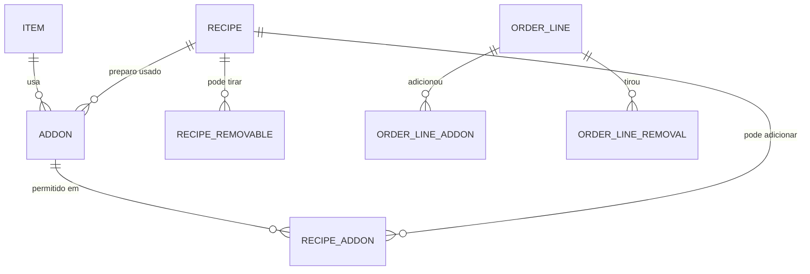

# Modelo de dados: 010 — Adicionar e tirar ingredientes por botão

Migração `0010_addons`, depois da `0009_ordering` ([modelo da 009](../009-pedidos-qr-mesa/data-model.md)).
Toda tabela nova tem `id`, `restaurant_id`, `created_at`, `created_by`, RLS `tenant_isolation` e
`GRANT` para `app_user`.

## `addons` (adicional) — editável

| Coluna | Tipo | Regra |
|---|---|---|
| `name` | `text` | 1 a 40 caracteres |
| `name_normalized` | `text` | Único entre ativos: `(restaurant_id, name_normalized) where active` (`NAME_IN_USE`) |
| `item_id` | `uuid` null → `items` | Exatamente um de `item_id` e `sub_recipe_id` (check) |
| `sub_recipe_id` | `uuid` null → `recipes` | Preparo (`kind = SUB_RECIPE`, conferido na aplicação) |
| `quantity` | `numeric(14,4)` | `> 0` |
| `unit_id` | `uuid` → `units` | Mesma família da medida do item ou do rendimento do preparo |
| `price` | `numeric(12,2)` | `>= 0`; zero = "Grátis" |
| `active` | `boolean` default `true` | Não é apagado |
| `updated_at`, `updated_by`, `version` | | Trava otimista |

## `recipe_addons` (o que o produto pode adicionar)

| Coluna | Tipo | Regra |
|---|---|---|
| `recipe_id` | `uuid` → `recipes` | Só produto vendido (aplicação) |
| `addon_id` | `uuid` → `addons` | Único com `recipe_id` |
| `max_times` | `smallint` | 1 a 5 (check) |
| `position` | `smallint` | Ordem dos botões |

## `recipe_removables` (o que o produto pode tirar)

| Coluna | Tipo | Regra |
|---|---|---|
| `recipe_id` | `uuid` → `recipes` | |
| `item_id` / `sub_recipe_id` | `uuid` null | Exatamente um (check); único com `recipe_id` |
| `label` | `text` | 1 a 40; padrão "Sem {nome}" |
| `position` | `smallint` | |

Até 10 adicionais e 10 retiradas por produto (domínio, `TOO_MANY_OPTIONS`). As duas tabelas são
trocadas inteiras pelo quadro do produto (R7), dentro da trava otimista de `recipes`.

## `order_line_addons` — só inserção

| Coluna | Tipo | Regra |
|---|---|---|
| `order_line_id` | `uuid` → `order_lines` | |
| `addon_id` | `uuid` → `addons` | Referência |
| `name` | `text` | Nome no envio (cópia) |
| `times` | `smallint` | 1 a 5 |
| `unit_price` | `numeric(12,2)` | Preço do adicional no envio, `>= 0` |
| `item_id` / `sub_recipe_id` | `uuid` null | Componente no envio (cópia); exatamente um |
| `quantity` | `numeric(14,4)` | Quantidade por vez, no envio |
| `unit_id` | `uuid` → `units` | |

## `order_line_removals` — só inserção

| Coluna | Tipo | Regra |
|---|---|---|
| `order_line_id` | `uuid` → `order_lines` | |
| `item_id` / `sub_recipe_id` | `uuid` null | Exatamente um |
| `label` | `text` | Texto do botão no envio |

Únicos: `(order_line_id, addon_id)` e `(order_line_id, item_id, sub_recipe_id)`.

## Mudanças na 009 (`order_lines`)

| Coluna | Antes (009) | Agora |
|---|---|---|
| `note` | texto até 140 | **sai** |
| `base_price` | – | `numeric(12,2)`, preço de venda do produto no envio, `> 0` |
| `unit_price` | preço do produto | `base_price + Σ(adicional.unit_price × times)`; conferido no domínio, check `unit_price >= base_price` |

Como a 009 ainda não foi implementada, essas mudanças entram direto na `0009_ordering`; a
`0010_addons` só cria as tabelas desta feature.

## Regras do domínio

- **Preço da linha** (`priceLine`): `basePrice + Σ(addon.price × times)`; total da linha =
  preço × quantidade.
- **Escolha válida** (`validateCustomization`): cada adicional está ligado ao produto, ativo, com
  componente ativo, `1 ≤ times ≤ max_times`, sem repetir; cada retirada está no produto e o
  componente existe na versão mais nova; sem repetir.
- **Texto para a cozinha** (`describeChanges`): adicionais na ordem do produto como
  "+ {times} {nome}" (o 1 aparece: "+ 1 Fatia de queijo"), depois retiradas como "SEM {resto do
  texto}" a partir de "Sem …".
- **Consumo** (`lineConsumption`): ver [research R6](research.md#r6-consumo-da-linha).
