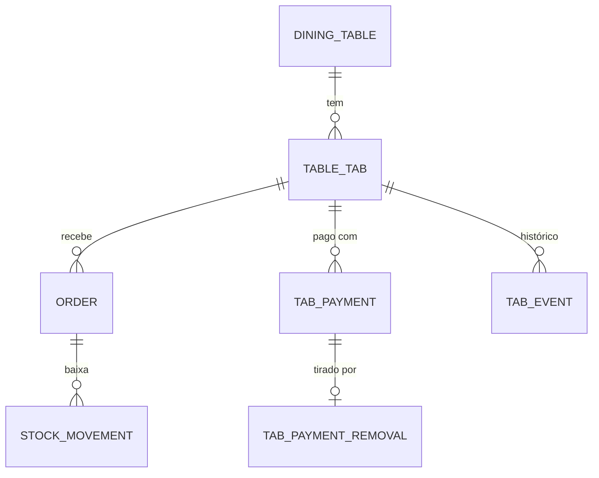

# Modelo de dados: 011 — Fechar a conta da mesa e baixar o estoque

Migração `0011_tabs`. Toda tabela nova tem `id uuid pk` (UUID v7 gerado na aplicação),
`restaurant_id`, `created_at`, `created_by` (`base`), RLS `tenant_isolation` e `GRANT` para
`app_user`. Omitidos abaixo.



## `table_tabs` (conta da mesa) — editável

| Coluna | Tipo | Regra |
|---|---|---|
| `table_id` | `uuid` → `dining_tables` | Único entre as abertas: `(restaurant_id, table_id) where status = 'OPEN'` |
| `status` | enum `tab_status`: `OPEN`, `CLOSED` | |
| `opened_at` | `timestamptz` | Hora do primeiro pedido |
| `service_rate` | `numeric(5,2)` null | Copiada do restaurante ao abrir; nulo = sem taxa. Check 0 a 20 |
| `service_waived` | `boolean` default `false` | Caixa tirou a taxa desta conta |
| `closed_at`, `closed_by`, `closed_day` | `timestamptz`, `uuid`, `date` null | Preenchidos se `CLOSED` (check). `closed_day` = dia local do fechamento, para a consulta (índice `(restaurant_id, closed_day)`) |
| `subtotal`, `service_charge`, `total` | `numeric(12,2)` null | Gravados no fechamento (retrato para a consulta); check `total = subtotal + service_charge` |
| `updated_at`, `updated_by`, `version` | | Trava otimista. Envio de pedido também soma 1 em `version` ([R2](research.md#r2-fechar-sem-perder-pedido-que-chegou-junto)) |

Transições: `OPEN → CLOSED` (fechar, FR-004) e `CLOSED → OPEN` (reabrir, só gerente, FR-009). Ao
reabrir, `closed_*` e os valores gravados voltam a nulo; o evento guarda o motivo e os valores de
antes.

## `orders` (009) — coluna nova

| Coluna | Tipo | Regra |
|---|---|---|
| `tab_id` | `uuid` null → `table_tabs` | Preenchido pelo envio; nulo só em pedidos de antes da 011. Índice `(tab_id)` |

## `tab_payments` (pagamento) — só inserção

| Coluna | Tipo | Regra |
|---|---|---|
| `tab_id` | `uuid` → `table_tabs` | |
| `method` | enum `payment_method`: `CASH`, `PIX`, `DEBIT_CARD`, `CREDIT_CARD`, `OTHER` | |
| `amount` | `numeric(12,2)` | > 0; o que conta como pago |
| `received`, `change` | `numeric(12,2)` null | Só `CASH`; check `received = amount + change`, `change ≥ 0` |
| `client_request_id` | `uuid` | Único com `tab_id` (toque duplo) |

Gatilho `app_reject_change`; `app_user` só `SELECT, INSERT`.

## `tab_payment_removals` (pagamento tirado) — só inserção

`payment_id` (único) → `tab_payments`, `created_at`, `created_by`. Pagamento tirado não conta no
pago.

## `tab_events` (histórico da conta) — só inserção

| Coluna | Tipo | Regra |
|---|---|---|
| `tab_id` | `uuid` | |
| `kind` | enum `tab_event_kind`: `OPENED`, `PAYMENT_ADDED`, `PAYMENT_REMOVED`, `SERVICE_WAIVED`, `SERVICE_RESTORED`, `CLOSED`, `REOPENED` | |
| `reason` | `text` null | Obrigatório em `REOPENED` (1 a 140) |
| `details` | `jsonb` null | Valores relevantes (pagamento, totais antes de reabrir) |
| `at`, `user_id` | | `user_id` nulo só em `OPENED` (aberta pelo pedido do cliente) |

## `restaurants` — coluna nova

`service_charge_rate numeric(5,2) null default 10.00`, check 0 a 20. Nulo = taxa desligada. Mudar
vai para a auditoria (`serviceChargeRate`).

## `menu_accesses` (009) — coluna nova

`end_reason` enum `menu_access_end_reason` null: `RESCAN`, `TAB_CLOSED`. Preenchido junto com
`ended_at`. Os encerramentos antigos ficam com `RESCAN` (migração).

## `stock_movements` (004) — mudanças

| Mudança | Regra |
|---|---|
| `movement_type` + `SALE_RECIPE` | Saída por venda (tipo 7 do manual); quantidade negativa |
| `order_id uuid null` → `orders` | Obrigatório em `SALE_RECIPE` (check); preenchido no estorno e na perda do cancelamento |
| Check `stock_movements_reason` | `reason_id` obrigatório menos em `PURCHASE` e `SALE_RECIPE` |
| Índice único parcial | `(order_id, item_id) where order_id is not null and reason_id is null` (baixa uma vez só; só a venda tem pedido sem motivo, e o valor novo do enum não pode ir no predicado na mesma migração) |
| Motivos novos (seed) | `LOSS/ORDER_CANCELLED` "Pedido cancelado" (família Erro na operação); `REVERSAL/ORDER_CANCELLED` "Pedido cancelado" (família Estorno) |

## Papel

`role` + `CASHIER` ("Caixa").

## Regras de cálculo (domínio puro `src/domain/billing/`)

```text
subtotal      = Σ total dos pedidos da conta com status ≠ CANCELLED
serviço       = 0 se service_rate nulo ou service_waived
                senão round_half_up(subtotal × service_rate / 100, 2)
total         = subtotal + serviço
pago          = Σ amount dos pagamentos sem remoção
falta         = total − pago                       (negativa só se um pedido é cancelado depois de pago: a conta não fecha)
pode fechar   = falta = 0 e nenhum pedido em RECEIVED, PREPARING ou READY
partes(N)     = trunc(falta ÷ N, 2) para cada uma; a 1ª recebe falta − Σ das outras
```
