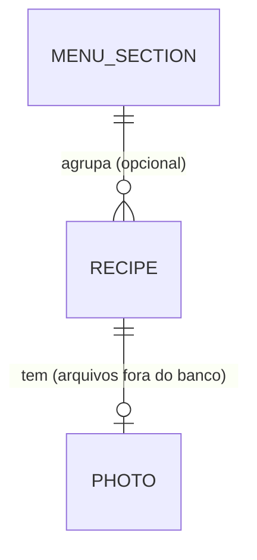

# Modelo de dados: 013 — Gerente e chef editam o cardápio

Migração `0013_menu_editing`, depois da `0012_performance`. A tabela nova tem `id`,
`restaurant_id`, `created_at`, `created_by`, RLS `tenant_isolation` e `GRANT` para `app_user`, como
as outras.



## `menu_sections` (seção do cardápio) — editável

| Coluna | Tipo | Regra |
|---|---|---|
| `name` | `text` | 1 a 40 caracteres, sem espaços nas pontas (`INVALID_NAME`) |
| `name_normalized` | `text` | Único no restaurante: `(restaurant_id, name_normalized)` (`NAME_IN_USE`). Sem maiúsculas e acentos, pela mesma função `normalizeDescription` dos outros cadastros |
| `position` | `integer` | `> 0`; densa (1..n) no restaurante; única adiável: `(restaurant_id, position) deferrable initially deferred`, para a troca de vizinhos caber numa transação |
| `updated_at`, `updated_by`, `version` | | Trava otimista para renomear |

A seção é apagada de verdade (não tem pedido nem histórico preso a ela); o que foi apagado fica na
trilha de auditoria. Os produtos da seção passam para `menu_section_id = null` na mesma transação.

## `recipes` (produto, 003) — colunas novas

| Coluna | Tipo | Regra |
|---|---|---|
| `description` | `text` null | Até 300 caracteres (check `char_length(description) <= 300`); texto simples; vazio é gravado como `null` |
| `menu_section_id` | `uuid` null → `menu_sections` | Nulo = "Outros". Chave estrangeira composta com `restaurant_id`, para nunca apontar para seção de outro restaurante |
| `menu_position` | `integer` not null default `0` | Posição dentro da seção (ou de "Outros"); densa (1..n) entre os produtos vendidos do grupo; `0` só em preparo |
| `photo_base` | `text` null | Endereço até o identificador da foto, sem a largura: `…/menu/{photoId}` |
| `photo_widths` | `smallint[]` null | Larguras gravadas, em ordem crescente, subconjunto de `{300, 600, 900, 1200}` |

Checks:

- `recipes_menu_only_dish`: `kind = 'DISH'` ou todas as colunas acima vazias (`description`,
  `menu_section_id`, `photo_base`, `photo_widths` nulos e `menu_position = 0`).
- `recipes_photo_pair`: `(photo_base is null) = (photo_widths is null)`; com foto,
  `cardinality(photo_widths) >= 1`.

Índice: `recipes_menu_order (restaurant_id, kind, menu_section_id, menu_position)`, para a tela
Cardápio e o cardápio do cliente. Entra em `tests/integration/performance/indexes.test.ts`.

Estas colunas **não** fazem parte da versão do produto (`recipe_versions`): mudar foto, descrição,
seção ou ordem não cria versão e não muda pedido enviado. Descrição e seção sobem a `version` da
linha de `recipes` (trava otimista); foto e posição não.

## Dados existentes

```sql
-- Produtos vendidos de hoje ficam em "Outros", na ordem alfabética que o cliente já vê.
update recipes r set menu_position = o.pos
from (select id, row_number() over (partition by restaurant_id order by name_normalized) as pos
      from recipes where kind = 'DISH') o
where o.id = r.id;
```

## Arquivos da foto (fora do banco)

| Caminho | Conteúdo |
|---|---|
| `menu/{photoId}/300.webp` | 300 × 225, miniatura da tela Cardápio |
| `menu/{photoId}/600.webp` | 600 × 450, sempre existe |
| `menu/{photoId}/900.webp` | 900 × 675, se a foto recortada tiver pelo menos 900 px de largura |
| `menu/{photoId}/1200.webp` | 1200 × 900, se tiver pelo menos 1200 px |

`photoId` é um UUID v4 novo a cada envio. WebP, recorte central 4:3, sem metadados, cache
`public, max-age=31536000, immutable`.

## Regras de domínio (`src/domain/menu/`)

| Função | Regra da spec |
|---|---|
| `checkPhotoFile({ type, bytes, width, height })` | JPG, PNG ou WebP (`PHOTO_TYPE`); até 10 MB (`PHOTO_TOO_BIG`); lado menor ≥ 600 px (`PHOTO_TOO_SMALL`) — US1.3 |
| `variantWidths(croppedWidth)` | Larguras de `{300, 600, 900, 1200}` que não passam da foto recortada — FR-003 |
| `photoSrcSet(base, widths)` | Monta `srcset`; sem foto devolve `null` — US6.3, US6.10 |
| `cleanDescription(text)` | Tira espaços das pontas, mantém quebras de linha, vazio vira `null`, mais de 300 dá `INVALID_DESCRIPTION` — US1.6, US1.7 |
| `checkSectionName(name, existing)` | Obrigatório, até 40, único sem maiúsculas e acentos — US2.1 |
| `move(ids, id, "up" \| "down")` | Troca com o vizinho; primeiro não sobe, último não desce (`NO_CHANGE`) — US2.3, US3.1 |
| `appendPosition(positions)` | Produto novo ou que muda de seção entra no fim — US3.2, US3.3 |
| `buildCustomerMenu(sections, products, today)` | Seções na ordem, "Outros" no fim, seção vazia some, sem título quando nenhum produto tem seção, só o que o cliente pode pedir — US2.4, US2.5, FR-005 |

## Permissão

`menu.write` em `src/domain/access/permissions.ts`: `MANAGER` (tem todas) e `CHEF`.

## Auditoria (`audit_log`)

| Ação registrada | Dados |
|---|---|
| `menu.details` | produto, antes e depois de descrição e seção |
| `menu.photo.set`, `menu.photo.remove` | produto, base da foto anterior e da nova |
| `menu.product.move` | produto, seção, posição antes e depois |
| `menu.section.create`, `.rename`, `.move`, `.delete` | seção, nome ou posição antes e depois; ao apagar, quantos produtos foram para "Outros" |
| negada | ação tentada, por quem (padrão das outras telas) |

## Glossário (entra em `docs/sistema/glossario.md`)

| Termo | Código |
|---|---|
| Seção do cardápio | `menu_section` |
| Outros (sem seção) | `menu_section_id = null` |
| Posição no cardápio | `menu_position` |
| Descrição do produto no cardápio | `description` |
| Foto do produto | `photo` (`photo_base`, `photo_widths`) |
| Tela Cardápio da equipe | `menu board` |
| Pré-visualização | `preview` |
| Matriz de telas | `screen matrix` |
