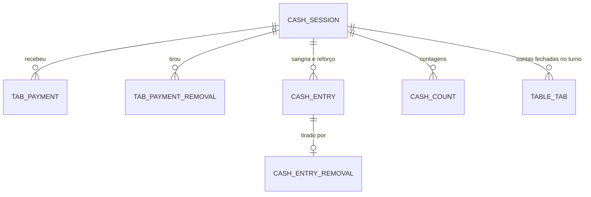

# Modelo de dados: 014 — Abrir e fechar o caixa do dia

Migração `0014_cash_sessions` (a 013 reserva a `0013`). Toda tabela nova tem `id uuid pk` (UUID v7
gerado na aplicação), `restaurant_id`, `created_at`, `created_by` (`base`), RLS
`tenant_isolation` e `GRANT` para `app_user`. Omitidos abaixo. Dinheiro em `numeric(12,2)`.



## `cash_sessions` (turno do caixa) — editável até fechar

| Coluna | Tipo | Regra |
|---|---|---|
| `status` | enum `cash_session_status`: `OPEN`, `CLOSED` | Único aberto: `(restaurant_id) where status = 'OPEN'` |
| `business_day` | `date` | Dia do restaurante na abertura. Índice `(restaurant_id, business_day)` |
| `opened_at`, `opened_by` | `timestamptz`, `uuid` | |
| `opening_float` | `numeric(12,2)` | ≥ 0 |
| `previous_kept` | `numeric(12,2)` null | O que ficou na gaveta no último turno fechado; nulo no primeiro turno |
| `opening_note` | `text` null | 1 a 140; obrigatória se `previous_kept` não é nulo e ≠ `opening_float` (check) |
| `closed_at`, `closed_by` | `timestamptz`, `uuid` null | Preenchidos só em `CLOSED` (check) |
| `expected`, `counted`, `difference`, `kept`, `service_charge` | `numeric(12,2)` null | Retrato do fechamento (`service_charge` = taxa das contas fechadas no turno, congelada para a reabertura de uma conta não mudar o turno fechado). Check: todos preenchidos em `CLOSED`; `difference = counted − expected`; `0 ≤ kept ≤ counted`; `counted ≥ 0` |
| `closing_count_id` | `uuid` null → `cash_counts` | A contagem usada no fechamento |
| `close_note` | `text` null | 1 a 140; obrigatória se `difference ≠ 0` (check) |
| `updated_at`, `updated_by`, `version` | | Trava otimista; +1 a cada pagamento, remoção, sangria, reforço e remoção de lançamento |

Transição única: `OPEN → CLOSED`. Gatilho `cash_session_closed_is_final`: linha `CLOSED` não aceita
`UPDATE` (turno fechado não muda, SC-004).

## `cash_entries` (sangria e reforço) — só inserção

| Coluna | Tipo | Regra |
|---|---|---|
| `cash_session_id` | `uuid` → `cash_sessions` | Índice `(cash_session_id)` |
| `kind` | enum `cash_entry_kind`: `WITHDRAWAL`, `SUPPLY` | Sangria, reforço |
| `amount` | `numeric(12,2)` | > 0 |
| `reason` | enum `cash_withdrawal_reason` null: `SAFE`, `SUPPLIER_PAYMENT`, `DAILY_EXPENSE`, `OTHER` | Obrigatório em `WITHDRAWAL`, nulo em `SUPPLY` (check) |
| `note` | `text` null | Até 140; obrigatória quando `reason = 'OTHER'` (check) |
| `client_request_id` | `uuid` | Único com `cash_session_id` (toque duplo) |

Gatilho `app_reject_change`; `app_user` só `SELECT, INSERT`.

## `cash_entry_removals` (lançamento tirado) — só inserção

`entry_id` (único) → `cash_entries`, `created_at`, `created_by`. Só no turno do próprio
lançamento, enquanto aberto (o caso de uso confere).

## `cash_counts` (contagem) — só inserção

| Coluna | Tipo | Regra |
|---|---|---|
| `cash_session_id` | `uuid` → `cash_sessions` | Índice `(cash_session_id, created_at)` |
| `counted` | `numeric(12,2)` | ≥ 0 |
| `denominations` | `jsonb` null | `{ "200": 1, …, "0.05": 3 }` quando a calculadora foi usada; conferido pelo domínio (soma = `counted`) |
| `session_version` | `integer` | `version` do turno quando a contagem foi gravada |

## `tab_payments` e `tab_payment_removals` (011) — coluna nova

| Tabela | Coluna | Regra |
|---|---|---|
| `tab_payments` | `cash_session_id uuid null` → `cash_sessions` | `CHECK (cash_session_id IS NOT NULL) NOT VALID`: obrigatória em linha nova; as antigas ficam nulas. Índice `(cash_session_id, method)` |
| `tab_payment_removals` | `cash_session_id uuid null` → `cash_sessions` | Mesmo check `NOT VALID`. Índice `(cash_session_id)` |

As duas continuam só inserção; a coluna é preenchida no `INSERT`.

## `table_tabs` (011) — coluna nova

`cash_session_id uuid null` → `cash_sessions`: o turno aberto quando a conta fechou. Nulo em contas
de antes da 014 e na conta de R$ 0,00 fechada sem caixa aberto. Reabrir a conta não mexe nele; o
novo fechamento grava o turno de então. Por isso o turno fechado guarda a sua taxa em
`cash_sessions.service_charge`. Índice `(cash_session_id)`.

## Papel e permissões

Sem papel novo. Ações novas: `cash.operate`, `cash.close_any`, `cash.expected`, `cash.history`,
`sales.report` ([research R10](research.md#r10-permissões-e-menu)).

## Regras de cálculo (domínio puro `src/domain/cash/`)

```text
recebido(forma)          = Σ amount dos pagamentos do turno nessa forma
                           − Σ amount dos pagamentos do turno tirados no próprio turno
tirados de outro turno   = Σ amount das remoções feitas neste turno de pagamentos de outro turno
                           (ou sem turno, de antes da 014), por forma
esperado                 = troco inicial
                         + recebido(Dinheiro)
                         − tirados de outro turno(Dinheiro)
                         + Σ reforços não tirados
                         − Σ sangrias não tiradas
sangria permitida        = valor ≤ esperado
tirar reforço permitido  = esperado − valor ≥ 0
diferença                = contado − esperado          BALANCED (= 0) | OVER (> 0) | SHORT (< 0)
retirada do fechamento   = contado − fica na gaveta
abertura pede observação = previous_kept ≠ nulo e opening_float ≠ previous_kept
contagem por cédula      = Σ quantidade × valor = contado; valores em
                           200, 100, 50, 20, 10, 5, 2, 1, 0,50, 0,25, 0,10, 0,05
```

Um pagamento tirado no próprio turno não entra no recebido; tirado num turno seguinte, continua no
recebido do turno de origem (fechado, imutável) e sai em "tirados de outro turno" do turno de
agora.

## Relatório de vendas (consultas, sem tabela nova)

```text
turnos do período   cash_sessions com business_day entre de e até, com recebido por forma,
                    tirados de outro turno, esperado, contado e diferença
recebido do período Σ dos turnos acima, por forma
taxa de serviço     Σ service_charge de table_tabs com closed_day no período
produtos            order_lines ⨝ orders (business_day no período, status ≠ CANCELLED)
                    por recipe_id: Σ quantity, Σ quantity × unit_price
adicionais          order_line_addons ⨝ order_lines ⨝ orders (mesmo filtro)
                    por addon_id: Σ times × line.quantity, Σ times × line.quantity × unit_price
pendentes           pedidos do período em RECEIVED, PREPARING ou READY
```

Invariante testada (SC-006): Σ produtos = Σ `orders.total` dos pedidos não cancelados do período.
O valor dos adicionais já está dentro do valor de cada produto (`unit_price` da linha inclui os
adicionais); a tabela de adicionais é informativa e não soma no total.
